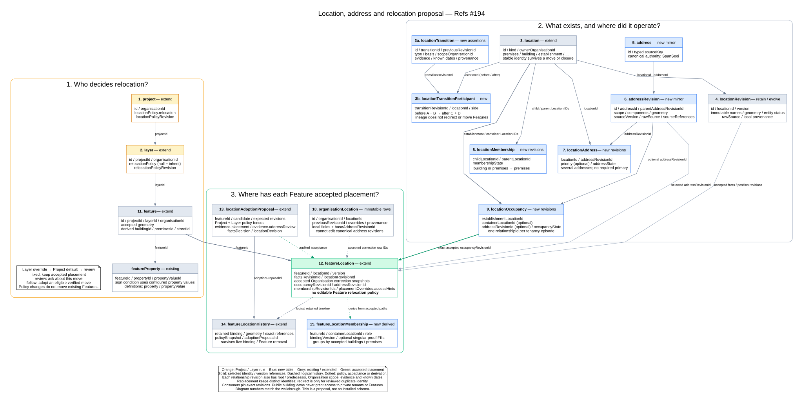

# Location identity, addresses and relocation: table walkthrough

The 10 November feature-creation implementation separates Feature kind, target context
and association relation. Project Location settings and Layer overrides use the shared
matching policy described in
[the implementation contract](../01-places-features.md#feature-intent-and-location-contexts-10-november-2026-refs-241-parent-186).
It extends local Location kinds to street and infrastructure; missing associations are
allowed and surfaced through the Feature index. This supersedes the earlier
association-required publication setting, without converting existing identities.

Draft for review, 22 October 2026. Refs
[#194](https://github.com/tijptjik/hype/issues/194), parent
[#180](https://github.com/tijptjik/hype/issues/180). Extends
[Locations and Features](../01-places-features.md). These are proposed Hype contracts,
not a wholesale installed schema or applied dataset migration. The policy-setting
portion described below is now implemented locally; the other target tables and
relocation execution remain proposed.

This feature set is pre-release. Keep its initial policy contract at v1 until
production: `coordinates.mode`, `address`, `unit` and `establishment` use `follow`;
`review` and coordinate `withinDistance` remain. There is one current schema, without
readers for superseded unpublished drafts. Missing `relocation` resolves to `review`.
Project Advanced and Layer Advanced editors share the normal form authorization,
save/cancel and revision-fence flows. The Layer columns are in
`migrations/0143_layer_relocation_policy.sql`. Pre-release contract adjustments belong
in the current migration plan rather than a new public schema version. Actual
occupancy-backed relocation handling is still inactive.

Implementation note (22 October 2026): migrations 0148–0150 and the corresponding local
relationship services/editor now implement the storage foundation. Occupancy-backed
relocation, canonical-address reconciliation and the complete A–Z operational workflow
remain incomplete. See the
[rollout and Breadline follow-up guide](../../../../docs/refactor-guides/Location-Lifecycle-Rollout.md)
for the exact boundary, rehearsal command and review fixtures. The target descriptions
below are requirements, not blanket claims of installed runtime behaviour.

Read the tables in order. Each table introduces only the fields relevant to this
proposal. Existing unrelated fields remain. A dotted name denotes a field inside JSON,
not an additional SQL column. **Existing**, **extended** and **new** describe the
current checkout relative to this target model.

Eight tables are new, including the two transition tables in 3a–3b. The other nine
numbered tables already exist and retain their unrelated fields. The existing Feature
property tables remain the authority for sign condition.

## Implemented building-part boundary (10 November 2026)

[#241](https://github.com/tijptjik/hype/issues/241), parent #186, implements a bounded
extension of the relationship model described here. The remaining scenario catalogue is
still a proposal unless separately evidenced. See the
[building-part implementation contract](../01-places-features.md#building-parts--local-implementation-10-november-2026).

A `building_part` is a physical wing, floor, zone, shop space, flat, room or other
identifiable building portion, independent of occupancy. A named wing or floor-only
identity is sufficient; complete structured 3D addresses are not required. Every part
created through local authoring has a current direct `locationMembership` to its
identified building. Optional part-to-part membership adds nesting in that same
building; it does not require intervening floors or wings. The owning edge remains
stable and cannot be suppressed or repointed. SQL guards reject self-parenting, cycles
and contradictory building membership.

Floor/unit address components are descriptive data, not automatic physical entities.
Existing address-only Locations remain unchanged; creating a part is deliberate, with no
invented upstream IDs or establishment placeholders. Occupants use the existing
`locationOccupancy` episodes, with `building_part` now a valid container alongside
buildings and premises. Turnover preserves part identity and its direct Feature links.

Current building-related Feature listings traverse current scoped part memberships and
current occupancy, deduplicate Features, and apply normal read authority before
pagination. Former and unconfirmed occupants remain outside the current related listing.
Retained accepted placement/history views retain their separate meanings; ancestor
projections use actual building/premises kinds and keep intermediate part revision pins.

The proposed physical labels are **IN BUILDING PART** and **ON BUILDING PART**. Current
association kind/sync intent remains separate from that future relation taxonomy; no
combined enum values or unrelated infrastructure kinds are introduced. Migration 0213
and local service/component evidence are documented in the linked contract. Neither
these checks nor this amendment establishes deployed or production acceptance.

## Scenario catalogue

The codes describe the supported cases and important failure paths in this proposal.
Define each context here once; the tables below describe only their participation and
field effects. Combine codes when cases overlap: for example, **Q + K + Y** applies the
follow rule, address-conflict handling and visibility checks together.

| Code                                                                               | Scenario and variants                                                                                                                                                                                                                                                          |
| ---------------------------------------------------------------------------------- | ------------------------------------------------------------------------------------------------------------------------------------------------------------------------------------------------------------------------------------------------------------------------------ |
| <a id="scenario-a"></a>**A — Register or associate a Location**                    | Select a source identity, create a shared unmatched/private manual identity, or leave kind, lifecycle, address or container unknown until evidenced.                                                                                                                           |
| <a id="scenario-b"></a>**B — Correct facts without replacing identity**            | Rename, rebrand, correct a point/footprint, or review a kind correction for the same continuing entity.                                                                                                                                                                        |
| <a id="scenario-c"></a>**C — Distinguish or reconcile identities**                 | A new branch or successor tenant is distinct. Duplicate-record merges and mistaken-identity splits need identity review; genuine entity mergers/splits retain separate before/after participants and evidence.                                                                 |
| <a id="scenario-d"></a>**D — Temporarily close and reopen**                        | An establishment pauses operation and resumes; this alone does not establish a move or the end of occupancy.                                                                                                                                                                   |
| <a id="scenario-e"></a>**E — Permanently close, then receive later evidence**      | Retain the closed establishment; distinguish a verified continuing-business reopening or erroneous report from a new tenant or a stale open source record.                                                                                                                     |
| <a id="scenario-f"></a>**F — Demolish or replace a building**                      | Retain the demolished structure and its history; a replacement structure gets its own identity, even at the same address. An evidenced replacement transition links them without redirecting the old building. Several old/new buildings can participate in one redevelopment. |
| <a id="scenario-g"></a>**G — Remove, restore or relocate a sign**                  | The sign condition changes independently of the business/building; a physical sign move requires evidence and an explicit placement decision.                                                                                                                                  |
| <a id="scenario-h"></a>**H — Revise canonical address content**                    | The same designation gains a curated name/number/street, spelling, point, scope or parent correction; distinguish this from a display-name change or Division-only update.                                                                                                     |
| <a id="scenario-i"></a>**I — Create or split an address identity**                 | A separately identified address or reviewed address split/supersession requires new canonical identity selection, not a silent rebase of the old address.                                                                                                                      |
| <a id="scenario-j"></a>**J — Select or qualify an address locally**                | Choose a canonical address/unit, add unlisted floor/unit details or access directions, or retain an unresolved local draft until suitable canonical data exists.                                                                                                               |
| <a id="scenario-k"></a>**K — Reconcile canonical changes and local overrides**     | Use the update, keep selected local fields, defer, retire newly redundant fields, or deliberately keep a historical version; an optional correction suggestion is separate.                                                                                                    |
| <a id="scenario-l"></a>**L — Choose and prioritise addresses**                     | One physical Location has multiple address designations; an occupant/Feature chooses the appropriate one without inferring an entrance or tenancy from that choice.                                                                                                            |
| <a id="scenario-m"></a>**M — Group buildings and nested premises**                 | Represent an estate/mall/airport, multiple or incomplete memberships, changed parentage and ambiguous containers without inventing floor/unit Locations.                                                                                                                       |
| <a id="scenario-n"></a>**N — Record or correct occupancy**                         | Establish, end or correct an episode; support uncertain dates, address-only/unconfirmed/multiple occupancy, scoped suppression and a later return to former premises.                                                                                                          |
| <a id="scenario-o"></a>**O — Relocate under fixed policy**                         | The establishment moves; the Feature keeps its accepted placement and association. A later explicit editor move remains possible.                                                                                                                                              |
| <a id="scenario-p"></a>**P — Relocate under review policy**                        | An editor moves this Feature, keeps it here or defers. A decision concerns this candidate, not all future moves or the Project/Layer setting.                                                                                                                                  |
| <a id="scenario-q"></a>**Q — Relocate under follow policy**                        | Adopt a verified eligible move; planned moves, identity uncertainty, incompatible overrides, missing target/pin or mandatory review remain blocked/pending.                                                                                                                    |
| <a id="scenario-r"></a>**R — Change Feature association or use a direct Location** | Link/reassociate to an establishment, building, premises, address-only or natural Location, or keep no Location association; the Feature subject need not be that Location.                                                                                                    |
| <a id="scenario-s"></a>**S — Accept facts and placement independently**            | Accept contact/name facts without moving, correct an access pin/address/unit coherently, or retain a local conflict for review.                                                                                                                                                |
| <a id="scenario-t"></a>**T — Configure policy or change Project/Layer**            | Set/clear inheritance and overrides, apply the six intended dataset settings, or reparent a resource; existing placement and rejected targets do not change automatically.                                                                                                     |
| <a id="scenario-u"></a>**U — Refresh, lose or recover a source**                   | Retain identical/new/stale source publications, omission and reappearance without treating missing inventory as closure or overwriting evidenced local history.                                                                                                                |
| <a id="scenario-v"></a>**V — Assert different Organisation corrections**           | Resolve baseline ownership and independent Organisation corrections, address choices or relationship suppressions without canonical editing or cross-scope propagation.                                                                                                        |
| <a id="scenario-w"></a>**W — Browse current and historical groupings**             | Query building/premises/street/Division views, current/former/unconfirmed occupants, accepted/past placements and related businesses now elsewhere.                                                                                                                            |
| <a id="scenario-x"></a>**X — Unlink, archive, unpublish or delete a Feature**      | Change editorial visibility or remove the live binding while retaining Location/address/relationship history and original media context.                                                                                                                                       |
| <a id="scenario-y"></a>**Y — Enforce or change visibility and authority**          | A readable building, public Feature, private target, different Organisation or revoked permission must not leak data or authorize a write.                                                                                                                                     |
| <a id="scenario-z"></a>**Z — Handle concurrency, replay and migration**            | Reject stale edits, deduplicate retries, resume fan-out safely and rehearse guarded schema/data conversion with preservation and rollback evidence.                                                                                                                            |

For each table, **Scenario effects** names the relevant fields and whether the case
appends an assertion, accepts a Feature change, derives a projection, reads history, or
leaves that table unchanged. An unlisted table has no write due solely to that scenario.
Ordinary authorization/read checks still apply. Related scenarios can add effects; a
rename also changing an address uses **B + H**, not B alone.

A new assertion does not itself accept a change for every Feature. Exact accepted
revisions stay pinned until an authorized adoption commits. The catalogue is a design
index, not a claim of implemented or verified acceptance.

<a id="table-project"></a>

## 1. `project` — the default relocation rule

**Extended existing table.** Put the control in Project **Advanced** settings.

| Field                       | Purpose and what it enables                                                             |
| --------------------------- | --------------------------------------------------------------------------------------- |
| `id`                        | Identifies the Project. Features and Layers refer to it.                                |
| `organisationId`            | Identifies the owning Organisation. Existing Project write authorization applies.       |
| `locationPolicy.relocation` | Chooses `fixed`, `review` or `follow`. An absent value means `review`.                  |
| `locationPolicyRevision`    | Changes when the policy changes. A pending move cannot commit against an obsolete rule. |

Extend the existing versioned `locationPolicy` contract; do not replace its other
adoption settings or store a second Project relocation preference in `flags`.

**Scenario effects**

| Scenario                                             | Effect on this table                                                                                                                                                                       |
| ---------------------------------------------------- | ------------------------------------------------------------------------------------------------------------------------------------------------------------------------------------------ |
| [T](#scenario-t)                                     | Set `project.locationPolicy.relocation` in Advanced settings; absent means `review`. Increment `locationPolicyRevision`. A Layer with an explicit override retains its own effective rule. |
| [O](#scenario-o), [P](#scenario-p), [Q](#scenario-q) | The resolved `locationPolicy.relocation` supplies consent/review behavior. This table does not store occupancy or move any Feature.                                                        |
| [Y](#scenario-y), [Z](#scenario-z)                   | Check `organisationId`, Project write authority and the expected `locationPolicyRevision`. A setting change does not authorize a stale or previously rejected adoption.                    |

<a id="table-layer"></a>

## 2. `layer` — an optional exception to the Project rule

**Extended existing table.** Offer **Inherit from Project** by default, with the
effective value visible beside it.

| Field                      | Purpose and what it enables                                                           |
| -------------------------- | ------------------------------------------------------------------------------------- |
| `id`                       | Identifies the Layer. A Feature selects it through `feature.layerId`.                 |
| `organisationId`           | Identifies the owning Organisation. It must agree with the Project and Feature scope. |
| `projectId`                | Selects the parent Project and its default policy.                                    |
| `relocationPolicy`         | New nullable `fixed`, `review` or `follow` override. Null means inherit.              |
| `relocationPolicyRevision` | New version counter for this override. Clearing it also advances the counter.         |

**Policy resolution for [T](#scenario-t).** Resolve `layer.relocationPolicy`, then
`project.locationPolicy.relocation`, then `review`. There is no independent editable
Feature relocation policy.

| Effective rule | Result when the associated establishment moves                                                                                   |
| -------------- | -------------------------------------------------------------------------------------------------------------------------------- |
| `fixed`        | Keep the accepted placement. An editor can still explicitly correct or move the Feature.                                         |
| `review`       | Keep the accepted placement and ask an editor to decide on this move.                                                            |
| `follow`       | Adopt a verified, eligible move automatically. Keep the old placement and request review if the target is unresolved or blocked. |

`follow` replaces the previous draft name `auto`. It is advance consent for a coherent
relocation, not proof that a source candidate is the same business or that a physical
sign moved. Extend the existing adoption evaluator/executor to recognise that consent
for the whole move. Ordinary updates within the same occupancy retain the existing
coordinate/address/unit policies. Mandatory review constraints, authorization and local
conflicts still apply to relocation. Enabling `follow` should not require enabling
automatic unrelated facts updates.

Apply the following intended settings at the matching Project or Layer:

| Dataset                | Intended effective rule |
| ---------------------- | ----------------------- |
| Ghost Signs            | `fixed`                 |
| Neon                   | `fixed`                 |
| Breadline Donors       | `follow`                |
| Breadline Dropoffs     | `follow`                |
| Independent Bookstores | `follow`                |
| ELN                    | `fixed`                 |
| Anything unspecified   | `review`                |

These are explicit configuration requirements, not runtime rules inferred from names,
Feature flags or Location kinds. Before applying settings, resolve the actual persisted
Organisation/Project/Layer IDs and prepare the guarded change manifest. Donors and
Dropoffs remain distinct datasets even though their relocation rules agree. Changing
policy does not move Features immediately or revive previously rejected targets. Review
choices below decide one candidate; they do not change Project/Layer settings.

**Scenario effects**

| Scenario                                             | Effect on this table                                                                                                                                                                                                               |
| ---------------------------------------------------- | ---------------------------------------------------------------------------------------------------------------------------------------------------------------------------------------------------------------------------------- |
| [T](#scenario-t)                                     | Set or clear `layer.relocationPolicy`; null inherits through `projectId`. Increment `relocationPolicyRevision` on either action. The six dataset settings above are explicit configuration, not name-based inference.              |
| [O](#scenario-o), [P](#scenario-p), [Q](#scenario-q) | Resolve `relocationPolicy` before the Project default. The effective rule can differ across Layers sharing one establishment.                                                                                                      |
| [T](#scenario-t), [Y](#scenario-y), [Z](#scenario-z) | Changing `projectId`/`organisationId` requires the existing ownership/reparenting checks and invalidates captured policy/scope fences. Existing accepted spatial placement does not change merely because the parent/rule changed. |

<a id="table-location"></a>

### Historical presentation layers

`project.flags.showHistoricalLayers` defaults to false. When enabled, each ordinary
Layer has one persistent derivative identified by `layer.historicalSourceLayerId`. New
derivative IDs use `history:<sourceLayerId>`; an existing historic Layer may be
explicitly adopted during reviewed migration to preserve its permanent ID and settings.
The source FK is unique, so toggling never creates a second derivative. Disable hides
the derivative from public discovery but retains its translations, fields and styling.

`feature.isIntangible` selects historical presentation. It does not assert that an
associated establishment is permanently closed. `isVisitable=false` on an otherwise
current Feature represents temporary unavailability; it neither selects the historic
layer nor proves a canonical operating status. Physical condition remains a Feature
property. These editorial flags must not overwrite evidenced Location lifecycle. An
editor may explicitly associate a historical Feature with a Location, including a newly
created Location. Initial association retains the historical flag and the usual
ownership, revision and Feature concurrency guards; automatic baseline discovery
continues to exclude intangible Features.

Membership is system-managed within the same Project. Save responses include the routed
`feature.layerId` so admin prisms update immediately. Public ordinary-layer queries omit
historical Features; enabled historical layers expose only otherwise published,
authorized records. Drafts/archival/privacy keep their existing restrictions. A derived
Layer cannot be manually deleted, reparented or assigned arbitrary Features. Names,
fields, default visibility and map/marker styling remain configurable. A Black/White
image-marker option desaturates the photograph without changing source images.

Requested collection setup: Neon Current/Dismantled, Ghost Signs Current/Historic, and
Independent Bookstores Open/Permanently Closed, with Black/White markers for the last
historical layer. Neon Dismantled entries are explicitly marked intangible; existing
publication states are preserved. Dataset changes require exact-ID rehearsal and
before-images, not title-based matching or inferred closure dates.

## 3. `location` — the continuing real-world identity

**Extended existing table.** Each real-world identity has its own row.

| Field                 | Purpose and what it enables                                                                                                                                                 |
| --------------------- | --------------------------------------------------------------------------------------------------------------------------------------------------------------------------- |
| `id`                  | Permanent Hype identity. The entity retains it through moves or retirement.                                                                                                 |
| `kind`                | Identifies `unknown`, `premises`, `building`, `establishment`, `natural` or `address`. `premises` is the proposed addition.                                                 |
| `ownerOrganisationId` | Grants authority over an unmatched/manual baseline. It is not, by itself, the visibility rule.                                                                              |
| `ssId`                | Retains the existing SaanSeoi Place identity link. Additional source families need typed provider/family/ID keys before use.                                                |
| `state`               | Tracks linked, unresolved, manual or redirected identity. It does not mean open or demolished.                                                                              |
| `sourceAvailability`  | Tracks source publication availability. A missing source does not retire the entity.                                                                                        |
| `redirectTargetId`    | Selects the canonical record after a reviewed duplicate-identity merge. It says “these records describe the same entity”; it does not mean “another entity took its place”. |

A premises is grounds or an organised development: an estate, mall, airport or campus. A
building is a physical structure, including a block/tower/house when that is what the
evidence identifies. An establishment is a continuing branch or venue, not its brand,
operator, later tenant or every branch of the same business.

The existing `address` kind remains an address-only Location fallback; it references the
address resource below. Phases, sections, floors and units are not automatically Hype
Locations. An independently meaningful phase can be a premises Location. A frontage is a
physical side of a building facing a street. This proposal does not model frontages as
entities or address roles. A building can have several address associations; those
associations do not establish its street-facing sides or entrances.

**Replacement is different from a redirect.** If building A is demolished and B is built
on the same plot, A remains a historical building with its own ID, facts, occupants,
Features and images. A's `redirectTargetId` stays null. B gets its own ID. An evidenced
`locationTransition` links A to B, so A can show “replaced by B” and B can show
“previously A”. Neither page silently becomes the other. Demolition alone does not
establish a replacement; leave the transition absent until evidenced.

A redirect is appropriate if A and B were duplicate records of the **same** building.
The identity-review workflow chooses the surviving identity and retains its merge
receipt/history. A single redirect cannot describe one-to-many splits or a physical
redevelopment; the transition tables below supply that missing lineage.

**Scenario effects**

| Scenario                                                                                                   | Effect on this table                                                                                                                                                                                                                             |
| ---------------------------------------------------------------------------------------------------------- | ------------------------------------------------------------------------------------------------------------------------------------------------------------------------------------------------------------------------------------------------ |
| [A](#scenario-a)                                                                                           | Create/select `location.id` with an evidenced `kind`. Preserve an unknown kind or address-only fallback when classification is unresolved; `state` records source/manual matching separately.                                                    |
| [B](#scenario-b)                                                                                           | Retain `id`; a reviewed `kind` correction must agree with the new immutable facts envelope. A rename does not create a new entity.                                                                                                               |
| [C](#scenario-c)                                                                                           | Give distinct entities distinct `id` values. Only a reviewed duplicate-identity merge sets `redirectTargetId`; retain the existing review/receipt and reconcile dependent histories/scopes. A split cannot choose one arbitrary redirect target. |
| [F](#scenario-f)                                                                                           | Keep the old `id` and create a distinct replacement `id`; do not redirect. Append an evidenced replacement transition separately. Existing addresses, occupants and Features do not transfer automatically.                                      |
| [D](#scenario-d), [E](#scenario-e), [G](#scenario-g), [O](#scenario-o), [P](#scenario-p), [Q](#scenario-q) | Retain `id` and `kind`. Operation, sign condition and accepted Feature placement do not become identity-matching `state` values.                                                                                                                 |
| [U](#scenario-u)                                                                                           | Update `sourceAvailability` as supported. Do not delete `id`, convert missing inventory to closure, or assume a reappearing source is a new identity.                                                                                            |
| [V](#scenario-v), [Y](#scenario-y)                                                                         | `ownerOrganisationId` and `state` select existing baseline authority/visibility rules. A linked source baseline is not editable just because an Organisation owns a Feature.                                                                     |
| [R](#scenario-r), [X](#scenario-x)                                                                         | Link/unlink/delete the editorial Feature without deleting its Location. A Feature reassociation selects another existing/verified `id`; it does not rewrite the original identity.                                                               |

<a id="table-locationtransition"></a>

## 3a. `locationTransition` — an evidenced change between identities

**New proposed immutable assertion table.** This fills a gap in the earlier draft; it is
not an already implemented merger/split service. One event can involve several old and
new entities. Corrections append a new revision of the same event.

| Field                                            | Purpose and what it enables                                                                               |
| ------------------------------------------------ | --------------------------------------------------------------------------------------------------------- |
| `id`                                             | Pins this exact event assertion and its participant set.                                                  |
| `transitionId`                                   | Identifies the continuing event across corrections.                                                       |
| `previousRevisionId`                             | Pins the preceding assertion in this authoring scope.                                                     |
| `scopeOrganisationId`                            | Null means the authoritative shared assertion; otherwise it is that Organisation's scoped correction.     |
| `assertionState`                                 | Asserts or suppresses the event in this scope without deleting its history.                               |
| `type`                                           | `replacement`, `merge`, `split` or `reconfiguration` describes the evidenced change.                      |
| `basis`                                          | `real_world` distinguishes an entity change from an `identity_correction` to our records.                 |
| `evidence`                                       | Supports both the transition and the claimed participants. A shared address alone is insufficient.        |
| `observedAt`, `verifiedAt`                       | Retain when the evidence was observed and verified, where known.                                          |
| `effectiveFrom`, `effectiveTo`                   | Retain the supported event beginning and end, each at a fixed granularity; unknown boundaries stay null.  |
| `effectiveFromPrecision`, `effectiveToPrecision` | Preserve day/month/year/decade precision using the shared boundary schema below, without inventing dates. |
| `provenance`, `actorId`, `recordedAt`            | Retain the source/review process, author and recording time independently of the event date.              |

These scope, correction-chain and date rules match the relationship assertions below.
Event endpoints are separate rows in 3b, rather than one `successorId` or a JSON list
without Location references. A transition records lineage; it does not itself change
lifecycle, redirect identity, end occupancy, transfer media or adopt Feature placement.
Those changes each need their own supported assertion and existing authorization.

**Scenario effects**

| Scenario                                             | Effect on this table                                                                                                                                                                                                                                            |
| ---------------------------------------------------- | --------------------------------------------------------------------------------------------------------------------------------------------------------------------------------------------------------------------------------------------------------------- |
| [C](#scenario-c)                                     | Record a reviewed `merge`/`split` with its `basis`. A duplicate merge may additionally use the existing identity redirect/receipt. A mistaken composite record can split into several corrected identities without redirecting all old Features to one of them. |
| [F](#scenario-f)                                     | Append `type=replacement`, `basis=real_world` only when replacement is evidenced. Several demolished buildings replaced by one tower, or one building replaced by several structures, share one event. Demolition without a known successor adds no transition. |
| [W](#scenario-w)                                     | Read the resolved event and participants to show predecessors, successors and a lineage timeline. Distinguish record corrections from actual redevelopment.                                                                                                     |
| [V](#scenario-v), [Y](#scenario-y), [Z](#scenario-z) | Authorize every participant and assertion scope, fence the expected event head, and commit a complete immutable participant set atomically. Scoped suppression is not evidence that an event never happened.                                                    |
| [U](#scenario-u), [X](#scenario-x)                   | Retain event evidence after source omission or Feature archival/removal.                                                                                                                                                                                        |

<a id="table-locationtransitionparticipant"></a>

## 3b. `locationTransitionParticipant` — the before and after identities

**New proposed immutable child table.** A participant belongs to an exact event
revision, not a mutable latest event.

| Field                  | Purpose and what it enables                                                                                                                                |
| ---------------------- | ---------------------------------------------------------------------------------------------------------------------------------------------------------- |
| `transitionRevisionId` | References `locationTransition.id`; corrections retain the preceding participant set.                                                                      |
| `locationId`           | References an existing Location without replacing its identity or facts.                                                                                   |
| `side`                 | `before` identifies a predecessor; `after` identifies a successor. Together the rows support one-to-one, one-to-many, many-to-one and many-to-many events. |

Use a unique key over all three fields. Each published assertion needs both sides;
validate cardinality against the reviewed `type`/`basis`. A continuing entity can keep
its ID only where the review explicitly establishes continuity. The participant list
does not declare every predecessor extinct or every successor a newly created entity.

**Scenario effects and concrete shapes**

| Scenario                           | Effect on this table                                                                                                                                                                                                                                                           |
| ---------------------------------- | ------------------------------------------------------------------------------------------------------------------------------------------------------------------------------------------------------------------------------------------------------------------------------ |
| [F](#scenario-f)                   | Replacement: A → B; redevelopment: A + B → C, or A → B + C. Retain all IDs and the separate demolition/creation assertions.                                                                                                                                                    |
| [C](#scenario-c)                   | Duplicate merge: absorbed A → surviving B, with `basis=identity_correction` and the existing merge receipt. Mistaken composite identity: A → B + C; affected bindings require review to select B, C or remain unresolved. A real merger/split instead uses `basis=real_world`. |
| [W](#scenario-w), [Y](#scenario-y) | Join `locationId` to show all permitted predecessors/successors. Check visibility before exposing participants, counts or traversals. A readable participant grants no access to private participants.                                                                         |
| [Z](#scenario-z)                   | Insert the complete endpoint set with its parent assertion; reject duplicates/incomplete events and keep prior participant sets immutable. Never repoint historical Feature, occupancy or address references merely because a transition exists.                               |

<a id="table-locationrevision"></a>

## 4. `locationRevision` — what was known about that identity

**Existing table, proposed naming and JSON changes.** Append versions; retain old ones.
The target names below are `version` and `rawSource`. Installed code still calls these
`sequence` and `payload`; their schema/service conversion requires a separate guarded
migration. This document does not rename installed columns.

| Field                            | Purpose and what it enables                                                                                                                                                      |
| -------------------------------- | -------------------------------------------------------------------------------------------------------------------------------------------------------------------------------- |
| `id`                             | Identifies an exact facts version. Consumers can retain it after later changes.                                                                                                  |
| `locationId`                     | Selects the identity these facts describe.                                                                                                                                       |
| `version`                        | Orders facts versions within this Location. It is not an effective date or the facts JSON format version.                                                                        |
| `origin`                         | Distinguishes source-synchronised and locally authored baselines.                                                                                                                |
| `facts.kind`                     | Captures the kind at that time. A later reclassification cannot reinterpret old facts.                                                                                           |
| `facts.common.names`             | Keeps the entity's accepted names, including historical versions.                                                                                                                |
| `facts.common.location.geometry` | Keeps its point. A later move does not overwrite the old point.                                                                                                                  |
| `facts.common.footprint`         | Optionally keeps its area geometry or immutable geometry reference.                                                                                                              |
| `facts.details.operatingStatus`  | For establishments: `open`, `temporarily_closed` or `permanently_closed`. Absent/null means unknown.                                                                             |
| `facts.details.buildingStatus`   | For buildings: `standing` or `demolished`. Absent/null means unknown.                                                                                                            |
| `rawSource`                      | Retains an immutable external source response, including resource and response metadata. Null for a purely local assertion; it is never edited into a local correction.          |
| `provenance`                     | Retains local authoring/review provenance and references to supporting evidence. Field-labelled evidence and observation/effective dates belong with the assertion they support. |
| `contentHash`                    | Identifies unchanged content for replay and deduplication.                                                                                                                       |
| `createdAt`                      | Records when Hype retained this version. It is not an asserted real-world event date.                                                                                            |

Other existing facts, such as phones and brands, remain. The persisted `facts` value is
a versioned envelope; the application already exposes a normalized display shape. New
address references must evolve that contract without rewriting old full snapshots.

**Source metadata is adapter evidence, not Location facts.** SaanSeoi's API contract,
release and snapshot IDs already occur in the retained resource/response metadata. They
need not be universal domain fields in this walkthrough. The installed adapter also
extracts `apiVersion`, `releaseId` and `snapshotId` into columns. Those are derived
copies, never independently editable assertions:

| Current extracted value | Actual operational use                                                                                                                                                                                 |
| ----------------------- | ------------------------------------------------------------------------------------------------------------------------------------------------------------------------------------------------------ |
| `apiVersion`            | Source ingestion requires it and source projections expose it; the retained response metadata identifies the contract used. It is not the Location's `version` and is not a chronology comparison key. |
| `releaseId`             | Candidate resolution matches the exact selected source resource release in SQL (`resolveLocationCandidate`). It prevents linking a similarly labelled result from another release.                     |
| `snapshotId`            | Identifies the pinned source snapshot and participates in exact-publication equality checks during refresh adoption; source address hydration validates its own address snapshot pins.                 |

The forward/stale publication comparison reads the retained `rawSource.meta` (currently
`payload.meta`), not an assumed ordering of opaque release/snapshot IDs. Keep only
justified adapter lookup/index projections when migrating this storage; removing those
columns requires replacing their consumers and integrity checks first. Do not maintain
two competing sources of truth. Purely local authoring evidence belongs in `provenance`,
while legacy mixed `payload` bytes remain retained as evidence.

The implemented JSON contract requires `unknown.details={}`. A non-empty brand list or
known operating status establishes an establishment; a known building status establishes
a building. Conflicting evidence is rejected. Classification and the owner-authored
identity update commit together. The nested address uses `snapshotId` and `rawSource`;
locality corrections store one `localityPath` rather than both a path and per-class IDs.
An absent path inherits, null follows the marker, and an empty path omits interpretive
localities. Migration `0144_location_address_contract.sql` converts retained application
envelopes without rewriting upstream payloads.

**Scenario effects**

| Scenario                                                               | Effect on this table                                                                                                                                                                                                                                                                               |
| ---------------------------------------------------------------------- | -------------------------------------------------------------------------------------------------------------------------------------------------------------------------------------------------------------------------------------------------------------------------------------------------- |
| [A](#scenario-a), [B](#scenario-b)                                     | Append a `locationRevision.id` and next `version` under the same `locationId` with the correct `facts.kind`, `common.names`, point/footprint, `rawSource` and authoring `provenance`. Keep the preceding revision unchanged.                                                                       |
| [C](#scenario-c)                                                       | Retain historical `locationId`/revision endpoints through identity review. A merge/split must review which continuing identity each accepted snapshot describes; it cannot rewrite old `rawSource` or reinterpret another branch's facts.                                                          |
| [D](#scenario-d)                                                       | Append `facts.details.operatingStatus=temporarily_closed`, then `open` when supported. Do not infer changed occupancy, address or editorial flags.                                                                                                                                                 |
| [E](#scenario-e)                                                       | Append `operatingStatus=permanently_closed` with supporting `rawSource` or local assertion evidence in `provenance`. A verified continuing-entity reopening/correction can append another version; a stale source value alone cannot retire an evidenced local assertion. A different tenant is C. |
| [F](#scenario-f)                                                       | Append `facts.details.buildingStatus=demolished` for the old `locationId`. Preserve `common.location.geometry`, `common.footprint` and older facts. The replacement structure uses another identity.                                                                                               |
| [G](#scenario-g)                                                       | No operating/building status change follows solely from a sign removal, restoration or transfer. Sign condition uses the existing `featureProperty` selection and its `property`/`propertyValue` definitions, not a Location fact or new Feature column.                                           |
| [H](#scenario-h)                                                       | Change `facts.common.names` only if the entity facts also changed. A canonical address revision alone does not rewrite this table or its retained source payload.                                                                                                                                  |
| [N](#scenario-n), [O](#scenario-o), [P](#scenario-p), [Q](#scenario-q) | Append a new position/facts baseline when those Location facts actually change. The occupancy assertion is separately revisioned; an occupancy-only change need not invent a new facts revision or move any Feature.                                                                               |
| [S](#scenario-s), [V](#scenario-v)                                     | Retain baseline revisions. Owner baseline edits append here; non-owner/source-linked local corrections belong in `organisationLocation`, not edited canonical `rawSource`.                                                                                                                         |
| [U](#scenario-u), [Z](#scenario-z)                                     | Use `contentHash` and adapter publication evidence to retain new source evidence or recognize a no-op. Missing/stale source data does not erase local correction history. `createdAt`/`version` never supply an invented effective date.                                                           |
| [W](#scenario-w), [X](#scenario-x)                                     | Read retained `id`, `rawSource` and `provenance` for historical facts even after current Feature binding or visibility changes. Do not rewrite old snapshots to fill new fields.                                                                                                                   |

<a id="table-address"></a>

## 5. `address` — one curated addressing identity

**New mirror table.** SaanSeoi owns canonical address identity/content. Hype retains
selected published versions. This is not a second independently editable address master.

| Field       | Purpose and what it enables                                                                                          |
| ----------- | -------------------------------------------------------------------------------------------------------------------- |
| `id`        | Stable Hype reference to this address identity. It is different from a building ID.                                  |
| `sourceKey` | Typed provider, source family and permanent source ID. It prevents collisions between different address inventories. |

One building can have several address identities, including addresses on different
streets. There is no assumed one-to-one mapping between addresses and physical sides.
Matching text does not prove two addresses are one identity. Source Address2D, Address3D
and unit references remain typed and are retained where supplied.

**Scenario effects**

| Scenario                                                               | Effect on this table                                                                                                                                                                               |
| ---------------------------------------------------------------------- | -------------------------------------------------------------------------------------------------------------------------------------------------------------------------------------------------- |
| [A](#scenario-a), [J](#scenario-j)                                     | Select/create a mirror `address.id` only for a verified canonical `sourceKey`. An unpublished draft or invented unit does not create a canonical mirror identity.                                  |
| [H](#scenario-h)                                                       | Keep `address.id` for a continuing designation; version its content in `addressRevision`.                                                                                                          |
| [I](#scenario-i), [L](#scenario-l)                                     | Retain distinct `id`/`sourceKey` values for separately identified addresses, including unit addresses and reviewed splits. Similar display strings or a shared building are not identity equality. |
| [C](#scenario-c), [F](#scenario-f)                                     | A change of tenant or building does not itself create an address identity. Canonical identity continuity/supersession requires separate source evidence.                                           |
| [U](#scenario-u), [W](#scenario-w), [X](#scenario-x), [Z](#scenario-z) | Retain existing `id`/`sourceKey` through omission, history reads and Feature removal. Replay must reuse the same canonical mirror identity.                                                        |

<a id="table-addressrevision"></a>

## 6. `addressRevision` — one published version of an address

**New immutable mirror table.** Only canonical-source synchronisation writes it.
Organisation editors cannot create or replace canonical revisions.

| Field              | Purpose and what it enables                                                                                                                       |
| ------------------ | ------------------------------------------------------------------------------------------------------------------------------------------------- |
| `id`               | Pins an exact address version. Historic displays stay reproducible.                                                                               |
| `addressId`        | Identifies the continuing address being versioned.                                                                                                |
| `scope`            | Says what the address identifies: premises, phase, building, section, floor, unit, unit portion or unknown. It is not tree depth.                 |
| `components`       | Holds structured source components and references. A qualified address may hold only its qualifiers and reference a base.                         |
| `geometry`         | Optional source address geometry (GeoJSON Point or null initially). It is not automatically the Feature's entrance pin.                           |
| `sourceVersion`    | Retains the upstream content-version identity where supplied.                                                                                     |
| `contentHash`      | Detects identical retained address content. Repeated publication alone does not create a new content version.                                     |
| `sourceReferences` | Pins the API/release/snapshot references known when this version was retained. These references remain immutable.                                 |
| `rawSource`        | Retains the canonical source record and metadata, including provider classifications and known effective dates. It is not editable local content. |
| `createdAt`        | Records when Hype first retained this version.                                                                                                    |

`components` follows the source schema rather than creating renamed competing fields.
The exact mirror envelope and source-refresh observation receipts need implementation
review. Later observations of identical content belong in refresh evidence; they do not
mutate `sourceReferences` or create duplicate address-content revisions.
`sourceReferences` is an immutable array of publication coordinates known at retention:

```ts
type SourceReference = {
  provider: string
  dataset: string
  apiVersion: string | null
  releaseId: string | null
  snapshotId: string | null
}
```

`sourceIds` would confuse publication coordinates with the stable record identity
already held by `address.sourceKey`. `sourceReleaseIds` would omit API and snapshot
coordinates. These are typed projections from `rawSource` for adapter validation,
release lookup and snapshot checks; they do not replace the raw evidence. Unknown
coordinates stay null. They never determine an effective date. A later publication of
identical content is recorded by refresh evidence, not appended to this array.

Address content retains names and component designators, without physical parentage,
premises organisation or premises purpose. SaanSeoi and Hype share this boundary through
`@saanseoi/address` 0.2.2. Hype migration 0146 archives retained authored objects before
removing `parentAddressId`, `premisesType` and `premisesKind`; raw source evidence stays
intact. SaanSeoi source-curation parentage remains evidence for the future
building/place model. The upstream in-place hash rewrite is documented in
`docs/datasets/address-content-migration.md` in the sibling repository. Live activation
requires coordinated database maintenance and deployment; it has not been performed.

Physical containment belongs to `locationMembership`. Address associations have no
coverage field. A frontage is a side of a building facing a street or open space; an
address on that frontage may designate the whole building. Neither the address nor its
number range establishes physical containment, occupancy or an entrance.

**Scenario effects**

| Scenario                                                               | Effect on this table                                                                                                                                                                                                                                                          |
| ---------------------------------------------------------------------- | ----------------------------------------------------------------------------------------------------------------------------------------------------------------------------------------------------------------------------------------------------------------------------- |
| [H](#scenario-h)                                                       | Only synchronisation appends `addressRevision.id` for a curated content change under the same `addressId`. Pin corrected `components`, `scope`, `geometry`, parent and `rawSource` as supplied. A Division-only or display-name change does not by itself require a revision. |
| [I](#scenario-i)                                                       | Retain old `addressId`/versions; mirror the new canonical identity and first revision. Do not rewrite historical parentage or automatically rebase overrides onto a split/successor identity.                                                                                 |
| [J](#scenario-j), [L](#scenario-l)                                     | Select an exact `id` for the chosen base or qualified address. Retain source-reported parentage as evidence; unpublished qualifiers remain local. Address point and parentage do not prove an entrance, occupancy or physical membership.                                     |
| [K](#scenario-k), [V](#scenario-v)                                     | Canonical `rawSource` and versions remain unchanged by Organisation accept/keep/defer/retire choices. Those choices change scoped corrections and accepted bindings only.                                                                                                     |
| [M](#scenario-m)                                                       | Source parentage remains evidence. Physical grouping is expressed by `locationMembership`, without an address-parent pointer.                                                                                                                                                 |
| [U](#scenario-u), [W](#scenario-w), [X](#scenario-x), [Z](#scenario-z) | Retain canonical versions after omission or unlinking. Identical `contentHash` content is reused; later publication observations go in refresh evidence, without mutating immutable `sourceReferences` or creating duplicate content revisions.                               |

## Shared fields for the next three relationship tables

`locationAddress`, `locationMembership` and `locationOccupancy` all contain these
fields. Explain them once; each table below adds its endpoints and domain state.

| Field                    | Purpose and what it enables                                                                                         |
| ------------------------ | ------------------------------------------------------------------------------------------------------------------- |
| `id`                     | Identifies one immutable relationship revision. Accepted placements pin this value.                                 |
| `relationshipId`         | Identifies the continuing relationship episode across corrections. The first/root row supplies this identity.       |
| `previousRevisionId`     | Points to the preceding revision in this authoring scope. Null starts a scope's chain.                              |
| `scopeOrganisationId`    | Null means the authoritative baseline. An Organisation ID means that Organisation's assertion/correction.           |
| `assertionState`         | `asserted` uses the relationship; `suppressed` rejects it in this scope. Suppression does not mean a tenancy ended. |
| `evidence`               | Holds source URLs or immutable record/image references and the short evidence supporting the assertion.             |
| `observedAt`             | Records when the supporting observation was made, if known.                                                         |
| `verifiedAt`             | Records when verification occurred, if known.                                                                       |
| `effectiveFrom`          | Records the supported beginning of the relationship. Unknown stays null.                                            |
| `effectiveTo`            | Records its supported end. Null does not prove it is current.                                                       |
| `effectiveFromPrecision` | Distinguishes a known day, month, year or decade for the beginning.                                                 |
| `effectiveToPrecision`   | Does the same for the end.                                                                                          |
| `provenance`             | Identifies the source publication or authoring/review process and relevant retained references.                     |
| `actorId`                | Identifies the author/process where available. It does not invent a historical witness.                             |
| `recordedAt`             | Records when Hype stored the assertion. It is not an occupancy or demolition date.                                  |

### Evidence schema (v1)

`evidence` is an array of the following objects. The same contract applies to
`locationTransition`; `supports` names the exact assertion fields supported.

```ts
type Evidence = {
  source:
    | { kind: 'url'; url: string; accessedAt: string }
    | { kind: 'record'; resourceType: string; revisionId: string }
    | { kind: 'image'; imageId: string; contentHash: string }
  supports: string[]
  quotedText: string | null
  description: string | null
  sourceDate: KnownDate
}

type KnownDate =
  | { value: string; precision: 'day' } // YYYY-MM-DD
  | { value: string; precision: 'month' } // YYYY-MM
  | { value: string; precision: 'year' } // YYYY
  | { value: string; precision: 'decade' } // YYYY, divisible by 10: 1980
  | null
```

A URL must be HTTP(S); `accessedAt` is an ISO timestamp of retrieval, not the historical
event date. Record references must resolve to retained immutable revisions. Image
references pin retained image content by hash, not just a mutable image row. At least
one of `quotedText` or `description` must be non-empty; descriptions explain visual or
record evidence without fabricating quotations. `supports` must contain valid field
paths for the assertion being written. `sourceDate` is the source's known date, not an
inferred effective date. Unknown dates stay null. An empty evidence array means no
supporting references were supplied, not independent verification. Public projections
must authorize referenced material and omit private references, quotes and descriptions
that the viewer cannot access.

### Fixed date granularities (v1)

The relationship tables and `locationTransition` share one boundary validator. Each
`effectiveFrom`/`effectiveTo` string and its corresponding precision form a `KnownDate`
pair: both null, or both populated. Validate actual calendar days, months 01–12,
four-digit years, and decade values divisible by ten.

| Value        | Precision | Meaning                      |
| ------------ | --------- | ---------------------------- |
| `1987-04-12` | `day`     | That known day.              |
| `1987-04`    | `month`   | April 1987; day unknown.     |
| `1987`       | `year`    | 1987; month and day unknown. |
| `1980`       | `decade`  | The 1980s; year unknown.     |
| null         | null      | Unknown.                     |

There is no `interval` precision or boundary range object. Never manufacture January 1st
or December 31st to store a year. Beginning and end remain separate facts describing a
relationship's duration, not an uncertainty interval for one date. If evidence cannot
support a single granularity, leave the boundary unknown and retain the source wording
in evidence. Coarse dates must not imply exact ordering or automatically trigger a
relocation within that month, year or decade.

Resolve the baseline plus the authorized Organisation's latest explicit choices. A
scoped chain can correct/suppress the same root without overwriting the baseline.
Enforce one successor per scoped predecessor and one first row per root/scope; compare
the expected head atomically. A new physical episode gets a new root. The three tables
already retain their revision chains; they do not need three additional history tables.

**Shared scenario effects**

| Scenario                                                               | Effect on all three relationship tables                                                                                                                                                                                  |
| ---------------------------------------------------------------------- | ------------------------------------------------------------------------------------------------------------------------------------------------------------------------------------------------------------------------ |
| [D](#scenario-d), [E](#scenario-e), [F](#scenario-f), [N](#scenario-n) | Keep `observedAt`, `verifiedAt`, `recordedAt` and effective boundaries distinct. Retain unknown/approximate dates with their actual precision. Lifecycle evidence alone does not supply a precise relationship-end date. |
| [H](#scenario-h), [I](#scenario-i), [M](#scenario-m), [N](#scenario-n) | Correct a continuing episode by appending `previousRevisionId` under its existing `relationshipId`; a genuinely new relationship/occupancy episode gets a new root. Neither rewrites a Feature's accepted refs.          |
| [V](#scenario-v), [Y](#scenario-y)                                     | Resolve baseline plus permitted `scopeOrganisationId` chains. `assertionState=suppressed` is an editorial scope decision, not proof of a former tenancy, address association or premises grouping.                       |
| [U](#scenario-u), [W](#scenario-w), [X](#scenario-x), [Z](#scenario-z) | Retain every exact revision/evidence reference. Compare expected scoped heads, reject chain forks/cycles and preserve history through refresh, replay and live Feature removal.                                          |

<a id="table-locationaddress"></a>

## 7. `locationAddress` — which address describes a Location

**New relationship table.** Includes all shared fields above.

| Additional field    | Purpose and what it enables                                                                                                                                                              |
| ------------------- | ---------------------------------------------------------------------------------------------------------------------------------------------------------------------------------------- |
| `locationId`        | Identifies the addressed building, premises, establishment or address-only fallback.                                                                                                     |
| `addressRevisionId` | Selects the exact canonical address version. The stable address ID is obtained through it.                                                                                               |
| `priority`          | Optional non-negative integer for address presentation within this Location and resolved authoring scope. Lower numbers come first; null means unranked. No primary address is required. |
| `addressState`      | Marks this address association as current, former or unconfirmed.                                                                                                                        |

An address's `scope` describes its subject. Associate the appropriate address with the
Location it describes. An establishment's qualified shop/unit address can be selected
through `locationOccupancy.addressRevisionId`; it does not also need an association with
the hosting building. Multiple addresses and number ranges alone do not establish a
separate unit, an entrance or occupancy. This is a proposed relationship contract, not
an implemented table or an automatic classification of existing addresses.

### Address priority and selection

All addresses may have `priority=null`. Equal priorities are allowed; no uniqueness
constraint or requirement to assign zero applies. For example, priorities `10`, `20` and
null present two ranked choices followed by an unranked choice. Gaps allow insertion
without renumbering every address.

Resolve authorised baseline/scoped assertions first, then filter for the requested
current or historical view. Sort eligible associations by non-null priority ascending,
then unranked associations. Use stable `relationshipId` ordering within ties only for
reproducible presentation; it conveys no preference. A former or suppressed association
cannot become a current address merely by having a higher priority. A list may show
every eligible address; a single-address display may use a uniquely highest-ranked
eligible address. Tied best priorities or entirely unranked choices require an explicit
selection or a multiple-address presentation, not an invented primary address.

`scopeOrganisationId` lets an Organisation rank the same Location's addresses without
changing the shared baseline. A scoped revision explicitly setting `priority=null`
clears the preference in that scope; it does not inherit the baseline rank. With no
scoped correction, the baseline remains applicable. Priorities are local to
`locationId`, not global properties of `addressRevision`. An establishment can rank its
own address associations differently from its hosting building.

Priority edits use the same authorisation, immutable revisions and expected-head checks
as other relationship edits. Multi-address reorder operations must validate all affected
scoped heads and commit atomically; retries must not create duplicate revisions.
Clearing a preference does not suppress or retire the address association.

An explicit `locationOccupancy.addressRevisionId` or accepted
`featureLocation.addressRevisionId` takes precedence over presentation priority.
Reordering never changes those selections, moves a Feature or edits a canonical address.
Priority is editorial preference, so changing it must not manufacture historical
effective dates or source evidence. Existing revisions retain their ranks for historical
reproduction. The proposed v1 UI offers rank/reorder and clear-priority actions, shows
ties/unranked choices, and never demands a primary selection.

**Scenario effects**

| Scenario                                                                                 | Effect on this table                                                                                                                                                                                                                                                                                                                          |
| ---------------------------------------------------------------------------------------- | --------------------------------------------------------------------------------------------------------------------------------------------------------------------------------------------------------------------------------------------------------------------------------------------------------------------------------------------- |
| [A](#scenario-a), [J](#scenario-j), [R](#scenario-r)                                     | Assert the selected `locationId` → `addressRevisionId` with an appropriate `addressState` and optional `priority`. An unresolved draft can remain outside this canonical-address relation; do not fabricate a target revision.                                                                                                                |
| [H](#scenario-h), [I](#scenario-i), [K](#scenario-k)                                     | Append a relationship revision only when the address choice/version for this Location is actually asserted or corrected. Preserve the former revision and do not silently update Features pinning it.                                                                                                                                         |
| [L](#scenario-l)                                                                         | Create separate evidenced address associations sharing `locationId`, with distinct selected addresses. Append revisions to change or clear `priority`, or correct `addressState`, through the same relationship root when the designation continues. Priority changes reorder eligible choices; they do not change accepted address bindings. |
| [C](#scenario-c)                                                                         | Include every affected `locationId`/relationship root in the identity impact review. Preserve immutable endpoints; append authorized replacement/correction assertions only when the reviewed mapping establishes them. Never merge address identities merely because Locations are reconciled.                                               |
| [M](#scenario-m), [N](#scenario-n), [O](#scenario-o), [P](#scenario-p), [Q](#scenario-q) | Read compatible `addressRevisionId` choices for a container/occupancy. Merely selecting an address does not create membership, tenancy or Feature movement.                                                                                                                                                                                   |
| [V](#scenario-v)                                                                         | Use `scopeOrganisationId`/`assertionState` for a local selection or suppression. Do not edit the shared canonical address or turn suppression into `addressState=former`.                                                                                                                                                                     |
| [U](#scenario-u), [W](#scenario-w), [X](#scenario-x), [Z](#scenario-z)                   | Retain relationship `id`/evidence and effective boundaries for historic selection. Compare the scoped head on append; source omission or Feature removal does not delete this chain.                                                                                                                                                          |

<a id="table-locationmembership"></a>

## 8. `locationMembership` — buildings and premises groupings

**New relationship table.** Includes all shared fields.

| Additional field   | Purpose and what it enables                                            |
| ------------------ | ---------------------------------------------------------------------- |
| `childLocationId`  | Identifies a building or a constituent premises.                       |
| `parentLocationId` | Identifies the containing premises, such as a mall, estate or airport. |
| `membershipState`  | Distinguishes current, former and unconfirmed membership.              |

**Scenario effects**

| Scenario                                                               | Effect on this table                                                                                                                                                                                                                                                                                                                                    |
| ---------------------------------------------------------------------- | ------------------------------------------------------------------------------------------------------------------------------------------------------------------------------------------------------------------------------------------------------------------------------------------------------------------------------------------------------- |
| [A](#scenario-a), [M](#scenario-m)                                     | Append evidenced `childLocationId` → `parentLocationId` and `membershipState`. Support several/nested memberships, unknown dates and incomplete inventories; reject cycles and invalid endpoint kinds.                                                                                                                                                  |
| [B](#scenario-b), [H](#scenario-h)                                     | A name/address correction does not move the physical child into another premises. Keep this table unchanged unless membership evidence also changes.                                                                                                                                                                                                    |
| [C](#scenario-c), [F](#scenario-f)                                     | A replacement structure needs its own child relationship. Retain the old membership; mark it former/end it only as supported, without inventing a demolition/end date from a report timestamp. An identity merge/split also impact-reviews `childLocationId`/`parentLocationId`, duplicate paths and possible cycles before any replacement assertions. |
| [N](#scenario-n), [O](#scenario-o), [P](#scenario-p), [Q](#scenario-q) | An establishment relocation reads the destination building/premises grouping. It does not move either building or rewrite their `parentLocationId`.                                                                                                                                                                                                     |
| [V](#scenario-v)                                                       | Append a scoped assertion/suppression using the shared chain fields. Do not delete another scope's membership or use suppression as evidence of a former physical grouping.                                                                                                                                                                             |
| [U](#scenario-u), [W](#scenario-w), [X](#scenario-x), [Z](#scenario-z) | Retain exact relationship `id`/boundaries. Historical Feature paths use accepted/as-of membership, not today's head. Source omission and Feature deletion do not remove this history.                                                                                                                                                                   |

<a id="table-locationoccupancy"></a>

## 9. `locationOccupancy` — where an establishment operated

**New relationship table.** Includes all shared fields.

| Additional field          | Purpose and what it enables                                                          |
| ------------------------- | ------------------------------------------------------------------------------------ |
| `establishmentLocationId` | Identifies the continuing establishment.                                             |
| `containerLocationId`     | Selects its building or premises. Null permits an address-only unresolved container. |
| `addressRevisionId`       | Optionally selects the appropriate address for this episode.                         |
| `occupancyState`          | Explicitly distinguishes current, former and unconfirmed occupancy.                  |

An occupancy address must be compatible with the container's established address
associations, or remain explicitly unresolved for review. If only an address is known,
retain it without inventing a building. Similar names, address ranges or footprints are
evidence for review, not automatic occupancy joins.

**Scenario effects**

| Scenario                                                               | Effect on this table                                                                                                                                                                                                                                                                                                              |
| ---------------------------------------------------------------------- | --------------------------------------------------------------------------------------------------------------------------------------------------------------------------------------------------------------------------------------------------------------------------------------------------------------------------------- |
| [A](#scenario-a), [N](#scenario-n)                                     | Append an episode for `establishmentLocationId`; use a known `containerLocationId`/`addressRevisionId` or leave the container null. Set `occupancyState` explicitly; no end date alone never means current. Multiple supported containers remain possible.                                                                        |
| [C](#scenario-c)                                                       | A replacement tenant/new branch uses its own `establishmentLocationId` and episode. Sharing `containerLocationId` or address does not establish continuity. A reviewed merge/split preserves prior endpoints and explicitly reconciles affected roots; it does not silently collapse episodes or assign another branch's history. |
| [D](#scenario-d), [E](#scenario-e), [F](#scenario-f)                   | Retain occupancy evidence independently of operating/building status. Append `occupancyState=former` or end boundaries only when supported; never derive an exact tenancy end from a closure/demolition report date.                                                                                                              |
| [J](#scenario-j), [L](#scenario-l), [M](#scenario-m)                   | Choose a compatible `addressRevisionId` and building/premises `containerLocationId`; address-only or multiple/unconfirmed cases remain explicit rather than forced into a single building.                                                                                                                                        |
| [N](#scenario-n), [O](#scenario-o), [P](#scenario-p), [Q](#scenario-q) | For an effective verified move, append the former episode revision and create the destination episode under a different `relationshipId`. A later return also gets a new root. The same `establishmentLocationId` continues. A future-move report alone does not make the destination current or the old episode former.          |
| [R](#scenario-r)                                                       | A direct building/premises/address/natural Feature needs no invented establishment occupancy. An unassociated Feature creates no row here.                                                                                                                                                                                        |
| [V](#scenario-v)                                                       | Scope local assertions/suppressions through `scopeOrganisationId`/`assertionState`. Suppressing a baseline episode does not assert a departure or delete its evidence.                                                                                                                                                            |
| [U](#scenario-u), [W](#scenario-w), [X](#scenario-x), [Z](#scenario-z) | Resolve current/former/unconfirmed tenants from scoped episode state and supported dates, independently of Feature placement pins. Preserve episodes through source omission/unlinking and fence every append to its expected head.                                                                                               |

<a id="table-organisationlocation"></a>

## 10. `organisationLocation` — local corrections without canonical editing

**Existing table, proposed immutable-row redesign.** Each row is one complete correction
version for an Organisation/Location pair. Earlier rows are the history; there is no
nested `history` array or mutable correction row.

| Field                                     | Purpose and what it enables                                                                                                                                                |
| ----------------------------------------- | -------------------------------------------------------------------------------------------------------------------------------------------------------------------------- |
| `id`                                      | Identifies this exact correction version. Accepted bindings pin this value.                                                                                                |
| `organisationId`                          | Selects the authoring/correction scope. Other Organisations do not inherit it.                                                                                             |
| `locationId`                              | Identifies the Location being corrected.                                                                                                                                   |
| `previousRevisionId`                      | References the preceding row for the same Organisation/Location pair. Null starts the chain.                                                                               |
| `overrides`                               | Complete snapshot of explicit local assertions at this version. Inherit, override and clear remain distinct.                                                               |
| `overrides.address.baseAddressRevisionId` | Proposed address-override field. Pins the canonical version the local fields were authored against. Null permits a visibly local draft.                                    |
| `overrides.address.fields`                | Proposed sparse structured address corrections/qualifiers. It does not copy an entire old rendered address.                                                                |
| `provenance`                              | Retains supporting evidence and authoring/review context, including exact reviewed canonical versions and decision references. Its typed envelope remains to be specified. |
| `actorId`                                 | Identifies the authorized author of this version.                                                                                                                          |
| `createdAt`                               | Records when this immutable version was stored, not when the described facts became effective.                                                                             |

The row's `id` replaces the old correction `revision` token; there is no duplicate
version identifier or `updatedAt`. The pair `(organisationId, locationId)` identifies
the chain, not a unique row. Enforce one root per pair with a partial unique index where
`previousRevisionId IS NULL`, and at most one successor per non-null predecessor.
Enforce predecessor ownership within the same pair, retain referenced rows and reject
cycles. Append only against the expected current head, in the same transaction as any
accepted binding or decision changes. Concurrent first writes and competing successors
must fail as stale; never choose a winner by timestamp.

The current head is the row without a successor in this pair. Read historical versions
by exact `id`, with the same Organisation/Location authorization as current versions.
`overrides` is a full correction snapshot, so resolving a selected version does not
require replaying the chain. An omitted field inherits; explicit clear remains a
separate override operation. Retiring the address correction appends a snapshot with
`overrides.address` absent while preserving unrelated corrections. Retiring every
correction appends `overrides={}`; it does not delete the chain or canonical revisions.

Existing reference names `featureLocation.factsOrganisationRevision`,
`featureLocation.locationOrganisationRevision` and
`locationAdoptionProposal.organisationRevision` now refer to `organisationLocation.id`.
The first two pin accepted versions; the last fences the reviewed current head. Null
means no correction version was selected or no head existed at assessment, respectively.
Validate the referenced row's Organisation and Location, not just its ID. Retained
Feature history pins the same immutable IDs. Appending a correction never changes a
Feature's accepted correction version on its own.

Unmatched/manual baseline ownership and existing correction authorization remain
authoritative. An Organisation's address selection and privately authored unit details
are not canonical `addressRevision` rows. A draft can exist without a canonical base; it
remains visibly local and never invents an upstream unit/inventory ID. Publication of
local content follows explicit Feature choices, not automatic shared promotion. A future
**Suggest correction** flow is optional and separate; SaanSeoi curation would still
approve publication.

**Choices for [K](#scenario-k).** Compare `overrides.address.baseAddressRevisionId`,
`overrides.address.fields` and the candidate canonical revision. C1 denotes the old
canonical version; C2 denotes the new candidate.

| Choice              | Effect                                                                                                                                                                                    |
| ------------------- | ----------------------------------------------------------------------------------------------------------------------------------------------------------------------------------------- |
| Use updated address | Append a correction row based on C2 and retire the superseded local fields in that new snapshot. Preserve unrelated local qualifiers unless explicitly replacing the whole address group. |
| Keep my address     | Append a new `organisationLocation` row based on C2. Reassert only the chosen local fields and keep compatible new canonical content.                                                     |
| Review later        | Retain the old base/override and the pending review.                                                                                                                                      |

After acceptance/rebase, automatically retire fields equal to the reviewed canonical
values. If no differences remain, retire the active address override and retain history.
An override equal to C1 while C2 differs is intentional old-value retention, not
redundancy. C1 itself is never deleted or retired by this rule. Rebase only compatible
continuing identities and coherent field groups; splits, relocation or
historical-version selection need explicit decisions. A correction-head change alone
does not rewrite linked Features. The proposal/decision table below retains the exact
reviewed pair and prevents repeat prompts.

**Scenario effects**

| Scenario                                                                                 | Effect on this table                                                                                                                                                                                                                                                                                                                                        |
| ---------------------------------------------------------------------------------------- | ----------------------------------------------------------------------------------------------------------------------------------------------------------------------------------------------------------------------------------------------------------------------------------------------------------------------------------------------------------- |
| [B](#scenario-b), [D](#scenario-d), [E](#scenario-e), [S](#scenario-s), [V](#scenario-v) | Keep local facts/position corrections in `overrides`, under the authorized `(organisationId, locationId)` and immutable `id`. Preserve owner baseline authority; never replace a linked source baseline with an Organisation-authored canonical version.                                                                                                    |
| [C](#scenario-c)                                                                         | Identity review must reconcile overlapping `(organisationId, locationId)` correction heads and ownership before a merge/split can proceed. Keep every correction row; do not choose the latest head or transfer private corrections implicitly.                                                                                                             |
| [J](#scenario-j)                                                                         | Store only authored address fields/qualifiers in `overrides.address.fields`, with `baseAddressRevisionId` where a base exists. An unlisted unit/draft remains visibly local without inventing a publisher identity. Feature-specific access directions belong in the proposed `featureLocation.placementOverrides.accessHints`, not this shared correction. |
| [H](#scenario-h), [I](#scenario-i), [K](#scenario-k)                                     | Apply the K choices above through a new correction row with `id` and `previousRevisionId`. Rebase only a continuing compatible identity; an address split or deliberate historical selection needs explicit selection, not automatic rebasing.                                                                                                              |
| [K](#scenario-k)                                                                         | Retire fields equal to the accepted canonical version; retire the active address override when no differences remain. Preserve earlier correction rows. Equality to an older canonical value while the reviewed candidate differs remains an intentional local assertion. Suggesting an upstream correction is a separate optional action.                  |
| [L](#scenario-l), [M](#scenario-m), [N](#scenario-n)                                     | Store relationship assertions in the three relationship tables with their own scope/chain. Do not hide occupancy or physical parentage inside an address override.                                                                                                                                                                                          |
| [U](#scenario-u), [V](#scenario-v), [Y](#scenario-y), [Z](#scenario-z)                   | Do not erase scoped `overrides` on refresh or expose another Organisation's corrections. Recheck author scope and expected head `id`; a changed correction head does not by itself update Features' accepted snapshots.                                                                                                                                     |

<a id="table-feature"></a>

## 11. `feature` — the Project's editorial record and map placement

**Extended existing table.** A sign and a donor role can be different Features for the
same establishment.

| Field                             | Purpose and what it enables                                                                                                                                                                                   |
| --------------------------------- | ------------------------------------------------------------------------------------------------------------------------------------------------------------------------------------------------------------- |
| `id`                              | Preserves the editorial record, images and associations through a move.                                                                                                                                       |
| `organisationId`                  | Determines the Feature's correction and authorization scope.                                                                                                                                                  |
| `projectId`                       | Selects the Project, including its relocation default.                                                                                                                                                        |
| `layerId`                         | Selects the Layer, including its inherited/overridden relocation rule.                                                                                                                                        |
| `geometry`                        | Stores the accepted Feature map/access pin. It need not equal a building centroid or address point.                                                                                                           |
| `addressMeta.address.accessHints` | Current storage only; proposed destination is `featureLocation.placementOverrides.accessHints`, versioned with this Feature’s accepted placement. Unassociated drafts retain their local hints until binding. |
| `buildingId`                      | New derived key for the one unambiguous accepted building. Null means unresolved or multiple.                                                                                                                 |
| `premisesId`                      | New derived key for the nearest one unambiguous accepted premises. All ancestors remain in the projection below.                                                                                              |
| `streetId`                        | Proposed derived address/access street key. It belongs to the street source domain, not Location.                                                                                                             |
| `isPublished`                     | Retains the independent publication choice.                                                                                                                                                                   |
| `isArchived`                      | Retains editorial archival. It is not permanent closure.                                                                                                                                                      |
| `isVisitable`                     | Retains Feature visitability. It is not business operation.                                                                                                                                                   |
| `isIntangible`                    | Retains Feature subject behavior. It is not building demolition.                                                                                                                                              |
| `modifiedAt`                      | Fences changes to the Feature while a placement proposal is pending.                                                                                                                                          |

Sign condition already belongs to the Feature property system. The local inventory has
the `condition` property with values including Complete Sign, Partial / Damaged, Outline
/ Imprint Only and Painted Over. Do not replace these with an invented fixed enum or a
`feature.signCondition` column.

| Existing property field                                   | Participation in sign condition                                                                                                                        |
| --------------------------------------------------------- | ------------------------------------------------------------------------------------------------------------------------------------------------------ |
| `property.id`, `property.key`                             | Identify the persisted condition definition in its Project/Organisation scope. Resolve that identity rather than inferring it from a translated label. |
| `featureProperty.featureId`, `featureProperty.propertyId` | Attach this Feature's condition to the appropriate existing property.                                                                                  |
| `featureProperty.propertyValueId`                         | Select the configured classifier value. Retain existing `value`/`valueJson` semantics for other property types.                                        |
| `propertyValue.id`, `propertyValue.propertyId`            | Identify the allowed condition value and its definition. Localized labels use `propertyValueI18n`.                                                     |

Dated sign evidence belongs in the existing Feature edit/history and retained image
evidence paths; this proposal does not claim `featureProperty` has observation-date
columns. A missing condition is unknown; it does not justify an invented value or a
lifecycle inference. A new removal/transfer category, if needed, is a separate reviewed
property-definition change. Historic capture dates and images must retain their original
context when a current Feature moves. Existing spatial Division memberships remain
marker-derived. Address-context divisions are labelled separately when they disagree
with the pin.

**Scenario effects**

| Scenario                                                               | Effect on this table                                                                                                                                                                                                                                                                                                                                                 |
| ---------------------------------------------------------------------- | -------------------------------------------------------------------------------------------------------------------------------------------------------------------------------------------------------------------------------------------------------------------------------------------------------------------------------------------------------------------- |
| [A](#scenario-a), [R](#scenario-r)                                     | Retain `feature.id` and select the editorial `organisationId`/`projectId`/`layerId`. Association is managed by `featureLocation`; direct or absent associations need no invented establishment.                                                                                                                                                                      |
| [B](#scenario-b), [D](#scenario-d), [E](#scenario-e), [F](#scenario-f) | Do not change `isPublished`, `isArchived`, `isVisitable` or `isIntangible` merely because an entity was renamed, closed or demolished. Geometry and media are retained unless separately edited.                                                                                                                                                                     |
| [G](#scenario-g)                                                       | Change the selected `featureProperty.propertyValueId` for the resolved condition property only with evidence and a supported configured value. Removal/restoration alone leaves `feature.geometry` unchanged. A verified physical transfer also uses explicit placement adoption; fixed policy never auto-transports a sign.                                         |
| [J](#scenario-j), [Q](#scenario-q), [S](#scenario-s)                   | Edit `featureLocation.placementOverrides.accessHints` for this Feature only (current runtime storage: `addressMeta.address.accessHints`). A relocation must retain, replace or clear directions explicitly according to their relevance; unresolved destination-specific directions require review. Retain the before/after values in normal edit/adoption evidence. |
| [O](#scenario-o), [P](#scenario-p)                                     | Leave `geometry`, `buildingId`, `premisesId` and `streetId` unchanged until an explicit move is accepted. A rejected/deferred candidate leaves the same Feature placement.                                                                                                                                                                                           |
| [Q](#scenario-q), [S](#scenario-s)                                     | On authorized acceptance, update `geometry` and the address/container-derived keys coherently, with routing work. Accepting contact/name facts alone does not change the pin; never reuse an incompatible old unit/entrance.                                                                                                                                         |
| [J](#scenario-j), [L](#scenario-l), [M](#scenario-m), [W](#scenario-w) | `buildingId` and nearest `premisesId` derive from accepted paths; multiple/unresolved results remain null. `streetId` derives from address/access context. Existing marker-derived Division membership stays separate.                                                                                                                                               |
| [H](#scenario-h)                                                       | A Division-only publication uses the existing geographic refresh to update affected marker-derived Division membership. It does not invent an address revision, move `geometry` or repoint accepted physical-container paths.                                                                                                                                        |
| [T](#scenario-t)                                                       | Changing `projectId`/`layerId` changes which policy governs future assessment; it does not move `geometry`. Reauthorize scope/correction use and invalidate old candidates.                                                                                                                                                                                          |
| [X](#scenario-x), [Y](#scenario-y)                                     | Apply editorial visibility through the existing flags and current read policy. Keep history/media context; archive/unpublish does not mean closed/demolished and does not grant access to private targets.                                                                                                                                                           |
| [Z](#scenario-z)                                                       | Check `modifiedAt` in adoption transactions; stale decisions cannot overwrite a newer editor change or produce partial projection updates.                                                                                                                                                                                                                           |

<a id="table-featurelocation"></a>

## 12. `featureLocation` — association plus the exact accepted placement

**Extended existing table.** One current accepted binding per associated Feature.

| Field                            | Purpose and what it enables                                                                                                                                   |
| -------------------------------- | ------------------------------------------------------------------------------------------------------------------------------------------------------------- |
| `featureId`                      | Selects the Feature. It is the binding's primary key.                                                                                                         |
| `locationId`                     | Selects the associated Location. A sign's subject is still the sign.                                                                                          |
| `version`                        | Identifies this accepted binding. Stale adoption cannot replace a newer one.                                                                                  |
| `factsRevisionId`                | Pins the accepted names/contact/entity facts version.                                                                                                         |
| `locationRevisionId`             | Pins the accepted Location position baseline. It can differ from the facts version.                                                                           |
| `factsOrganisationRevision`      | Pins `organisationLocation.id` for accepted facts corrections.                                                                                                |
| `locationOrganisationRevision`   | Pins the accepted Organisation corrections for position/address.                                                                                              |
| `overrides`                      | Retains accepted correction content. It is a snapshot, not another editable Feature-owned correction layer.                                                   |
| `occupancyRevisionId`            | New nullable reference to the exact accepted occupancy episode/version. A fixed sign can retain a former occupancy.                                           |
| `addressRevisionId`              | New nullable selected canonical address version. It is independent of later source revisions.                                                                 |
| `membershipRevisionIds`          | Unique exact `locationMembership.id` references accepted for this placement. Endpoints remain in those immutable rows; no copied paths or container payloads. |
| `placementOverrides.accessHints` | Feature-specific localized access directions accepted for this placement. Explicitly review them when changing destination.                                   |
| `actorId`                        | Identifies who/process accepted the binding.                                                                                                                  |

`membershipRevisionIds` is a deduplicated set of accepted membership revision IDs, not a
snapshot of complete paths. `occupancyRevisionId` supplies the establishment's accepted
container; a directly associated building/premises starts at `locationId`. The immutable
membership rows supply each child/parent edge. Resolve and validate connected, acyclic
paths from those references only. Build expanded paths in the rebuildable query
projection, not in the binding. This retains historical grouping without copying every
ancestor path into every Feature. No membership references are needed when the accepted
placement has no known premises ancestors.

`placementOverrides.accessHints` holds this Feature's localized directions as a
locale-to-text map, separate from shared Organisation corrections in `overrides`. A
changed destination requires explicit retain/replace/clear of these hints; unresolved
directions block automatic relocation. Accepted binding history retains the previous
map. The current runtime field is `feature.addressMeta.address.accessHints`; migrating
it to this proposed placement override must preserve every locale and historical text.
Feature-specific entrances must not leak into other Features via Organisation overrides.

There is no editable `featureLocation.placementMode`. Project/Layer configuration is the
policy source. The decision/history records the effective policy used at acceptance. An
old occupancy pin describes this Feature's placement, not today's tenancy state.

**Scenario effects**

| Scenario                                                                                 | Effect on this table                                                                                                                                                                                                                                                         |
| ---------------------------------------------------------------------------------------- | ---------------------------------------------------------------------------------------------------------------------------------------------------------------------------------------------------------------------------------------------------------------------------- |
| [A](#scenario-a), [R](#scenario-r)                                                       | Create/update the binding's `locationId`, same-Location `factsRevisionId`/`locationRevisionId`, accepted corrections and `version`. Direct physical Locations use paths rooted at the associated Location without an occupancy; an unassociated Feature has no live binding. |
| [C](#scenario-c)                                                                         | Reassociation to another entity selects that entity's baseline and compatible placement. Do not carry the old entity's footprint, unit or correction tokens into the destination by default; keep prior binding history.                                                     |
| [H](#scenario-h), [I](#scenario-i), [J](#scenario-j), [K](#scenario-k), [L](#scenario-l) | Pin the selected `addressRevisionId` and accepted scoped corrections only through authorized adoption. Canonical arrival, draft edits or correction acceptance do not automatically repoint all bindings.                                                                    |
| [M](#scenario-m), [N](#scenario-n)                                                       | Pin an accepted `occupancyRevisionId` and the deduplicated `membershipRevisionIds` set. Incomplete/alternative paths remain explicit. A changed physical hierarchy does not replace already accepted path revisions.                                                         |
| [O](#scenario-o)                                                                         | Keep `occupancyRevisionId`, address, position baseline and paths at the accepted placement. `locationId` can still identify the establishment now elsewhere. An explicit later move uses the normal adoption path.                                                           |
| [P](#scenario-p)                                                                         | Accepting the move advances the placement refs and `version`; rejecting/deferment leaves them unchanged. Keep the same associated `locationId` when continuity is verified.                                                                                                  |
| [Q](#scenario-q)                                                                         | Atomically advance occupancy/address/position/correction/path snapshots for a verified eligible target. If blocked or only planned, retain the complete old binding; no mutable latest-occupancy pointer.                                                                    |
| [B](#scenario-b), [D](#scenario-d), [E](#scenario-e), [G](#scenario-g), [S](#scenario-s) | Advance `factsRevisionId`/`factsOrganisationRevision` independently when eligible; do not imply a position change. Sign condition alone does not require a binding update. A genuine pin/address move updates the position group coherently.                                 |
| [T](#scenario-t), [U](#scenario-u), [V](#scenario-v), [Y](#scenario-y), [Z](#scenario-z) | No independent editable placement policy is stored here. Resolve current policy/authority and captured correction heads; source refresh alone does not rewrite accepted refs. Validate the target scope and compare `version` before any adoption.                           |
| [W](#scenario-w), [X](#scenario-x)                                                       | Read current accepted placement separately from occupancy's current state. On unlink/delete remove the live binding, while retaining its exact snapshots in `featureLocationHistory`.                                                                                        |

<a id="table-locationadoptionproposal"></a>

## 13. `locationAdoptionProposal` — one exact proposed change and its decision

**Extended existing table.** Reuse the existing review/adoption queue and executor. Do
not add another relocation task or decision ledger.

| Field                    | Purpose and what it enables                                                                    |
| ------------------------ | ---------------------------------------------------------------------------------------------- |
| `id`                     | Identifies the exact review/adoption candidate.                                                |
| `featureId`              | Identifies the Feature this candidate may change.                                              |
| `projectId`              | Captures the Project scope used during assessment.                                             |
| `layerId`                | Proposed captured Layer scope. Reparenting makes the old candidate stale.                      |
| `locationId`             | Pins the associated identity being assessed.                                                   |
| `candidateRevisionId`    | Pins the proposed Location facts/position baseline.                                            |
| `associationVersion`     | Captures the expected `featureLocation.version`.                                               |
| `featureModifiedAt`      | Captures the expected `feature.modifiedAt`.                                                    |
| `organisationRevision`   | Captures the expected `organisationLocation.id` head, or null when no correction chain exists. |
| `policyRevision`         | Captures the Project policy revision.                                                          |
| `layerPolicyRevision`    | New captured Layer policy revision. Even an inherited rule has a checked Layer fence.          |
| `evidence.policy`        | Retains the assessed policy, including the resolved relocation rule and its source.            |
| `evidence.placement`     | Proposed exact target occupancy/address/container paths and suitable map pin.                  |
| `evidence.addressReview` | Proposed base/candidate address versions and override head for an address-conflict review.     |
| `factsDecision`          | Retains the existing independent facts decision.                                               |
| `locationDecision`       | Records acceptance/rejection of this placement/address candidate, actor, time and reason.      |
| `createdAt`              | Records when the candidate was assessed, not the physical move date.                           |

Extend candidate uniqueness/replay keys with target occupancy/address and Layer policy
fences. An occupancy-only change can require a candidate even when Location facts are
unchanged. Preserve rejection identity across policy reassessment: a policy revision
alone must not reopen a rejected target. Recheck all captured heads and current
authority in the write transaction. No partial Feature/correction/projection update on a
stale decision.

Under `follow`, normal adoption records and accepts the eligible candidate. Verify
continuity of the same branch, an accepted current occupancy, compatible address,
unambiguous containers and a suitable new pin. Planned moves wait until effective.
Competing occupancy, identity/merge uncertainty, local address/unit/pin conflicts,
mandatory review or missing authority leave the old placement and create a review. Never
carry the old unit or entrance pin to the destination merely because its text still
parses. `fixed` neither auto-moves nor creates a routine relocation prompt; an explicit
editor move still uses the same audited acceptance path.

Move writes advance the marker, binding, address/correction snapshots, grouping and
routing work atomically for each Feature. An occupancy change itself only generates
candidates; it does not rewrite all linked Features. Fan-out can use the existing queue
in bounded batches, with durable idempotency/checkpoints per target and Feature binding.
One Project's decision does not authorize another Project's Feature.

For address overrides, `evidence.addressReview` plus `locationDecision` records which
canonical candidate/override pair was reviewed. Do not repeatedly prompt for that
resolved pair. A later relevant canonical version or new local correction can create a
new review. Organisation acceptance and individual Feature adoption remain distinct.

**Scenario effects**

| Scenario                                                                                 | Effect on this table                                                                                                                                                                                                                                                     |
| ---------------------------------------------------------------------------------------- | ------------------------------------------------------------------------------------------------------------------------------------------------------------------------------------------------------------------------------------------------------------------------ |
| [B](#scenario-b), [D](#scenario-d), [E](#scenario-e), [F](#scenario-f), [S](#scenario-s) | Assess changed facts through `candidateRevisionId`, `evidence.policy` and independent `factsDecision`. A status/name update is not automatically a location/relocation acceptance.                                                                                       |
| [H](#scenario-h), [I](#scenario-i), [J](#scenario-j), [K](#scenario-k)                   | Record the exact canonical/base/override pair in `evidence.addressReview`. Capture `organisationRevision`; retain a resolved `locationDecision` so the same pair is not repeatedly prompted. Splits require selection/identity review instead of an automatic rebase.    |
| [G](#scenario-g), [R](#scenario-r)                                                       | An explicit sign move/reassociation captures its verified destination in `evidence.placement` and follows existing identity/association authorization. Sign removal alone generates no relocation target.                                                                |
| [C](#scenario-c)                                                                         | Source identity, merge and split approval remains in the existing identity-review subsystem. Its impact preview must include the new relationship/address/accepted-path dependencies; a placement `locationDecision` cannot approve identity continuity on its own.      |
| [M](#scenario-m), [N](#scenario-n), [O](#scenario-o)                                     | An occupancy-only change can be assessed without a new facts version. A fixed Feature gets no automatic move or routine relocation prompt; a later explicit correction still records an exact candidate/decision.                                                        |
| [P](#scenario-p)                                                                         | **Move this Feature** accepts `evidence.placement`; **Keep here** records rejection in `locationDecision`; **Review later** leaves it undecided. Neither rejection nor acceptance changes the Project/Layer policy.                                                      |
| [Q](#scenario-q)                                                                         | Automatic acceptance requires a current verified occupancy, compatible address/containers and suitable pin. Planned-only evidence is not an executable move; reassess when effective/verified. Missing/competing evidence or mandatory review retains the old placement. |
| [J](#scenario-j), [K](#scenario-k), [S](#scenario-s), [Q](#scenario-q)                   | Expose local unit/address/pin/directions conflicts in `evidence.placement`/`evidence.addressReview`. Retain reviewed before/after access directions in adoption evidence; follow consent does not discard corrections or accept incompatible field groups.               |
| [T](#scenario-t)                                                                         | Capture `projectId`, `layerId`, `policyRevision` and `layerPolicyRevision`. Changed policy or reparenting invalidates an old assessment; it does not automatically reopen the same rejected target.                                                                      |
| [U](#scenario-u), [V](#scenario-v), [Y](#scenario-y), [Z](#scenario-z)                   | Retain new source evidence but do not infer a move/closure from omission. Recheck authority and all Feature/binding/correction/target fences; deduplicate target/pair retries and resume fan-out without duplicate acceptance.                                           |

<a id="table-featurelocationhistory"></a>

## 14. `featureLocationHistory` — retained placements and why they changed

**Extended existing table.** Keep one binding timeline, including unlink/deletion
evidence.

| Field                          | Purpose and what it enables                                                                                                     |
| ------------------------------ | ------------------------------------------------------------------------------------------------------------------------------- |
| `id`                           | Identifies an immutable history entry.                                                                                          |
| `featureId`                    | Retains the historical Feature identity without a cascading live-Feature FK.                                                    |
| `version`                      | Identifies the accepted binding version.                                                                                        |
| `previousVersion`              | Links the preceding binding version.                                                                                            |
| `action`                       | Records baseline, link, update or unlink.                                                                                       |
| `locationId`                   | Retains the associated identity at that time.                                                                                   |
| `factsRevisionId`              | Retains the accepted facts version.                                                                                             |
| `locationRevisionId`           | Retains the accepted position baseline version.                                                                                 |
| `factsOrganisationRevision`    | Retains the accepted scoped facts correction token.                                                                             |
| `locationOrganisationRevision` | Retains the accepted scoped position correction token.                                                                          |
| `overrides`                    | Retains the actual accepted correction snapshot.                                                                                |
| `placementOverrides`           | Retains Feature-specific access hints accepted at this version.                                                                 |
| `occupancyRevisionId`          | New retained accepted occupancy reference.                                                                                      |
| `addressRevisionId`            | New retained canonical address reference.                                                                                       |
| `membershipRevisionIds`        | Retained exact membership revision IDs; expanded paths are derived.                                                             |
| `geometry`                     | New accepted Feature pin snapshot. It preserves manually selected entrances too.                                                |
| `policySnapshot`               | New effective rule, source Project/Layer IDs and their revisions used for this acceptance. It is audit evidence, not a setting. |
| `adoptionProposalId`           | New optional link to the exact reviewed/automatic adoption candidate.                                                           |
| `actorId`                      | Retains who/process accepted the change.                                                                                        |
| `createdAt`                    | Records acceptance time. It does not invent the physical move date.                                                             |

Old history entries remain immutable even if they predate the proposed fields. Retaining
audit evidence never makes a deleted/private Feature publicly readable.

**Scenario effects**

| Scenario                                                                                                                                                         | Effect on this table                                                                                                                                                                                                             |
| ---------------------------------------------------------------------------------------------------------------------------------------------------------------- | -------------------------------------------------------------------------------------------------------------------------------------------------------------------------------------------------------------------------------- |
| [A](#scenario-a), [R](#scenario-r), [X](#scenario-x)                                                                                                             | Append `action=link/update/unlink` with the retained binding and `previousVersion` as appropriate. Feature removal does not cascade-delete historical `featureId` evidence.                                                      |
| [B](#scenario-b), [D](#scenario-d), [E](#scenario-e), [H](#scenario-h), [I](#scenario-i), [J](#scenario-j), [K](#scenario-k), [S](#scenario-s), [V](#scenario-v) | When a Feature actually accepts a changed group, retain the exact facts/position/correction/address refs and `overrides`. A new upstream/scoped assertion without Feature acceptance adds no fictitious accepted-binding entry.  |
| [O](#scenario-o), [P](#scenario-p)                                                                                                                               | A fixed, rejected or deferred move does not create a new accepted placement. Its binding history stays unchanged; a rejection/deferment belongs in the proposal lifecycle. A later accepted explicit/reviewed move appends here. |
| [Q](#scenario-q)                                                                                                                                                 | An accepted follow move appends exact occupancy/address/path refs, `geometry`, `adoptionProposalId` and effective `policySnapshot`. The previous accepted placement stays readable.                                              |
| [G](#scenario-g)                                                                                                                                                 | A sign-condition-only edit belongs in Feature condition/edit history, not a fabricated binding move. If an evidenced sign transfer is also accepted, retain the placement transition here.                                       |
| [L](#scenario-l), [M](#scenario-m), [N](#scenario-n), [W](#scenario-w)                                                                                           | Use retained `membershipRevisionIds`, `occupancyRevisionId` and `geometry` for past placement. Do not re-resolve every historical entry against today's tenancy, premises parent or address version.                             |
| [T](#scenario-t), [U](#scenario-u), [X](#scenario-x), [Y](#scenario-y), [Z](#scenario-z)                                                                         | Do not rewrite `policySnapshot` after a policy change or remove history after source loss/deletion. Apply current visibility rules to historical reads; replay must not duplicate an accepted revision.                          |

<a id="table-featurelocationmembership"></a>

## 15. `featureLocationMembership` — fast grouping by accepted containers

**New derived table.** Rebuild it from accepted paths, not current mutable relationship
heads.

| Field                  | Purpose and what it enables                                              |
| ---------------------- | ------------------------------------------------------------------------ |
| `featureId`            | Identifies the currently readable Feature to group.                      |
| `containerLocationId`  | Selects an accepted building or premises Location.                       |
| `role`                 | Labels the container as building or premises.                            |
| `bindingVersion`       | Pins the `featureLocation.version` used for this projection.             |
| `occupancyRevisionId`  | Optional singular occupancy proof, when one supports this row.           |
| `membershipRevisionId` | Optional singular premises-membership proof, when one supports this row. |

Use one deduplicated row per Feature/container/role. Complete alternative/nested paths
are reconstructed from `featureLocation.membershipRevisionIds`; the two optional proof
columns cannot represent every path. Index container/role/Feature. Do not scan every
JSON history on each page load.

**Views for [W](#scenario-w).**

| View                                      | Exact source and meaning                                                                                                         |
| ----------------------------------------- | -------------------------------------------------------------------------------------------------------------------------------- |
| Current/former/unconfirmed establishments | Resolve `locationOccupancy.containerLocationId` and `occupancyState` with scope and dates.                                       |
| Features placed here                      | Filter `featureLocationMembership.containerLocationId`. Includes direct building Features and accepted establishment placements. |
| Past accepted Feature placements          | Resolve retained `featureLocationHistory.membershipRevisionIds`, occupancy references and pins. Deduplicate with history links.  |
| Related business Features now elsewhere   | Join the building's occupancy establishments to `featureLocation.locationId`; label their actual accepted placement separately.  |

Do not plot every Feature of a former tenant at its former building. Do not use today's
premises hierarchy for all historical queries. Select exact accepted/as-of relationship
versions. These views cover recorded, authorized associations, not a guaranteed tenant
census.

**Scenario effects**

| Scenario                                                                                                   | Effect on this table                                                                                                                                                                                                                                               |
| ---------------------------------------------------------------------------------------------------------- | ------------------------------------------------------------------------------------------------------------------------------------------------------------------------------------------------------------------------------------------------------------------ |
| [A](#scenario-a), [R](#scenario-r)                                                                         | Derive `featureId`/`containerLocationId`/`role` from the accepted direct or occupancy-backed paths. An unassociated or unresolved Feature gains no invented building row.                                                                                          |
| [C](#scenario-c)                                                                                           | Rebuild only after the reassociation is accepted; the new business's historic occupants do not automatically become this Feature's accepted placement.                                                                                                             |
| [O](#scenario-o), [P](#scenario-p)                                                                         | Keep existing rows for a fixed/rejected/deferred move. Rebuild only on an accepted explicit/reviewed placement.                                                                                                                                                    |
| [Q](#scenario-q)                                                                                           | In the same acceptance transaction derive destination rows and `bindingVersion`; replace obsolete current rows while retaining past placement in history.                                                                                                          |
| [J](#scenario-j), [K](#scenario-k), [L](#scenario-l), [M](#scenario-m), [N](#scenario-n), [S](#scenario-s) | Derive all accepted buildings/premises ancestors, deduplicated by Feature/container/role. Preserve complete alternatives in the binding paths; singular proof columns are optional. Recompute scalar building/premises/street keys from the same accepted context. |
| [W](#scenario-w)                                                                                           | Read `containerLocationId` for physically placed Features. Read occupancy for tenant lists and history for former Feature placements; related businesses elsewhere are a separately labelled join. Never join every Feature to every past tenancy.                 |
| [T](#scenario-t), [U](#scenario-u), [V](#scenario-v)                                                       | Policy/source/correction-head changes alone do not rebuild spatial rows. Rebuild only after a relevant accepted binding change; retain scoped proof and apply current permissions during reads.                                                                    |
| [X](#scenario-x), [Y](#scenario-y)                                                                         | Remove current rows when the live association/Feature is removed; archive/unpublish alone follows ordinary visibility filters. Historical audit stays separate, and indexes/counts/previews must not expose private targets.                                       |
| [Z](#scenario-z)                                                                                           | Check `bindingVersion` and rebuild idempotently from the same accepted paths. Do not traverse mutable latest relationship heads to manufacture a different result.                                                                                                 |

## Relationship diagram

[Open the rendered table diagram](location-address-occupancy.svg) ·
[Graphviz source](location-address-occupancy.dot).



Solid edges show identity/version references. Dashed edges show logical retained
history; dotted edges show policy resolution or derived grouping. The diagram omits
unrelated existing tables and some provenance fields to keep it readable. Its field
labels use the same names as this walkthrough. History evidence intentionally survives
live Feature deletion; it is not a new cascading FK from history to a live binding.

## Authorization, historical discovery and delivery

Existing Organisation/Project authorization remains authoritative. A readable building
does not grant access to every occupant, Feature, override or related private Location.
Enforce visibility before joins expose rows, counts or pagination; recheck write scope
and every accepted target inside the transaction. Private drafts and scoped corrections
remain scoped in previews, history and projections. Never publish a private target
through a public relationship.

Closure, demolition and source disappearance retain identities, geometry/address, media,
aliases and evidence. Status does not archive, unpublish or delete anything.
Building/history views retain historical records with visible labels. Ordinary discovery
must not add a hidden open/standing filter; any future live-only filter is explicit.
Apply the specific condition/lifecycle boundaries in [D](#scenario-d)–[G](#scenario-g).

Implementation order: policy contracts and canonical mirror readers; relationship
revision storage/scope guards; accepted binding/proposal/history extension; then
grouping projections and UI. Coordinate Hype migration names centrally. Evolve strict
JSON contracts and authorization/server projections as well as SQL. No runtime/schema
change or dataset setting application is performed by this document.

Unspecified Projects/Layers resolve to `review`, including existing Features. Preserve
their accepted pins/bindings during migration; the default creates reviews for future
moves, not immediate adoption. Apply the six explicit dataset settings only from a
reviewed exact-ID plan, with old policy values/revisions, before/after counts, rollback
material and replay checks. Do not turn existing `successorLocationId` into relocation
continuity automatically: it may identify a successor tenant.

The `organisationLocation` redesign must flatten each retained `history` entry into an
immutable row. Preserve its existing revision token as `id`, its exact overrides, actor,
timestamp and provenance, and link predecessors in retained array order. Verify unique
tokens, scope ownership and agreement between the last entry and the old live head;
report inconsistencies as conflicts rather than guessing or discarding versions.
Preserve all existing accepted correction tokens and verify they resolve to the same
snapshots after migration. The initial migration plan must replace the pair primary key
with the row primary key and chain constraints, with guarded before-images, before/after
version counts, reference checks, replay verification and rollback material. Readers,
writers, validators and acceptance transactions now use immutable correction rows
through migration 0149; migration 0154 applies the v1 field names. See the
[rollout guide](../../../../docs/refactor-guides/Location-Lifecycle-Rollout.md) for
local evidence and remaining rollout boundaries. No remote migration is applied by this
draft.

Canonical address extraction from existing full snapshots needs its own guarded plan;
retain backward-compatible readers and every immutable source payload. The mirror's
typed source key and adapter mapping of `sourceReferences` still need implementation
review with SaanSeoi. Fixed date serialization and evidence use the v1 contracts above.
They do not authorize remote rollout.

### Scenario acceptance — design requirements, not runtime results

The catalogue and per-table effects define the acceptance scope for **A–Z**, including
combinations and unchanged-table assertions. The following checklist calls out
integration checks. Checked items have local service/rehearsal evidence in the rollout
guide. Unchecked items remain unverified across all variants; fixture page navigation
does not complete them.

#### Required acceptance evidence — local verification only

- [x] Correction-array migration preserves every version and accepted reference;
  root/successor races and cross-scope references fail; retirement appends a row and
  historic reads remain authorized.

- [ ] Closed establishment in a standing building retains former/current/unconfirmed
  occupancy evidence.
- [ ] Surviving business and removed sign remain distinct, with the sign fixed at its
  accepted building.
- [ ] Demolished building and unknown-status record remain readable in authorized
  historical views.
- [x] Replacement lineage retains both building IDs without a redirect; evidenced
  multi-building redevelopment supports multiple before/after participants.
- [ ] Duplicate identity merges retain redirect receipts; reviewed splits retain every
  result and do not arbitrarily reassign accepted bindings.
- [ ] Sign condition continues to use existing scoped property/value identities
  independently of Location lifecycle.
- [x] [O](#scenario-o), [P](#scenario-p), [Q](#scenario-q): fixed/review/follow outcomes
  retain separate associations, placements and decisions.
- [x] Project default, Layer inheritance/override/clear and the six persisted dataset
  mappings resolve correctly.
- [x] Policy changes, reparenting, stale edits and rejected targets cannot silently
  adopt a move.
- [ ] Multiple address choices and priorities, nested premises, multiple/unresolved
  buildings and address-only occupancy group correctly.
- [x] Canonical address review accepts/reasserts/retires sparse overrides without
  rewriting other Features.
- [x] Local address/unit/pin conflicts and planned moves stop automatic adoption with an
  actionable review.
- [ ] Source omission/stale open data preserves historical assertions, accepted
  placements and immutable media context.
- [ ] Private-target joins, counts, previews and writes enforce scope; unlinks/deletion
  retain non-public audit evidence.
- [x] Populated local migration rehearsal preserves IDs, publication, ownership and
  unrelated tables; replay is a no-op.

Placement service acceptance (Refs #194) runs on a private SQLite copy with an explicit
Wrangler persistence path. Synthetic policy layers must not be written into the normal
development collection; closed-layer creation remains gated by `showHistoricalLayers`.

### Historical bookstore layer migration

The 2026-11-10 rehearsal identified cohort drift: 43 features, including `XVcVi4bs_Lg4`,
and edited Clockwork Cat placement. The reviewed reconciliation passed disposable-copy
rollback, replay, preservation and contract checks, then applied successfully to local
D1 together with migrations `0209` and `0210`.

The reviewed cohort explicitly excludes Wah Koon Building (`XVcVi4bs_Lg4`), which is not
a former bookstore. Clockwork Cat accepts either its original fixture or its exact
reviewed editor state. The latter retains its address metadata, translations and map pin
while receiving the historical occupancy association; original fixture evidence remains
unchanged. All other source drift fails closed.

Migration `0207_former_bookstore_occupancy.sql` covers **all 42 reviewed features** in
the Independent Bookstores Permanently Closed layer (`history:RfWMLs_jW6QJ`). The
reviewed inventory and API evidence are in
`scripts/locations/fixtures/former-bookstores.json`. An exact layer-cohort guard rejects
added, removed or moved records before initial application; a prior five-record pilot
receipt cannot count as completion of this whole-layer migration.

Each record receives a Hype-local permanently closed establishment and a former
occupancy with unknown dates. Intangible Feature status, map pins and old revisions
remain intact. The migration appends attributed revisions and accepted placement
references. It does not publish upstream establishments. Original address text is
retained and parsed into components; contradictory old geocoder output is kept as
historical evidence rather than adopted. Bare ambiguous tokens remain visible. The
existing parser misses some literal floors/rooms (including `7F`, `7/Fl.` and
`Room 1102`); reviewed corrections are recorded alongside parser evidence.

The building API supports 32 links to 30 distinct host buildings. Shared hosts are
reused rather than recreated. Apollo's user-confirmed Flat A, 2/F, Wing Lee Building,
27–33 Kimberley Road is corroborated by the API's Apollo Book / 智源書局 address and
position evidence and the named Kimberley Road building. No canonical address
association is invented for that building, and the old Feature pin is not silently
moved. Source absence does not imply demolition or nonexistence.

The remaining ten establishments receive address-only former occupancy:

| Establishment      | Host result                                                                                                                                                                                                                     |
| ------------------ | ------------------------------------------------------------------------------------------------------------------------------------------------------------------------------------------------------------------------------- |
| Clockwork Cat      | ambiguous: Two overlapping API building identities carry Por Mee Factory Building, 500 Castle Peak Road.                                                                                                                        |
| Mellow Out         | ambiguous: Original text contains two different hosts: Tsun Win Factory Building, 60 Tsun Yip Street, and Wing Cheung Industrial Building, 109 How Ming Street. Occupancy order/dates are unknown; do not select or merge them. |
| Living Bookspace   | ambiguous: Shun Fung Building at Fung Yau Street North maps to a named footprint and an additional footprint carrying 9 Fung Yau Street North. Shop 39 does not disambiguate.                                                   |
| Trend Gallery      | ambiguous: Two overlapping API building identities carry Carnarvon Plaza, 20 Carnarvon Road.                                                                                                                                    |
| Mount Zero Books   | not-found: No exact 6B Tai Ping Shan Street building/address association found. A 6 Tai Ping Shan Street candidate is not an exact match.                                                                                       |
| Old Editor's Study | ambiguous: Block 13 and shopping-centre/podium footprints all carry City Garden, 233 Electric Road; the shop location cannot be assigned uniquely.                                                                              |
| Evergreen          | not-found: No 214 Johnston Road building/address association found in this API export.                                                                                                                                          |
| Urban Space        | ambiguous: Two overlapping API building identities carry On Ping Building, 47 Mei King Street.                                                                                                                                  |
| Fu Tei Bookstore   | not-found: No exact New Academic Building at Lingnan University found. Campus buildings have current names, but no verified alias connects this historical label.                                                               |
| Boxue Pavilion     | ambiguous: 55–69 Sai Yeung Choi Street South spans several distinct footprints; the original address does not select one.                                                                                                       |

Lookups use release-pinned, SHA-256-verified API exports at
`overture-2026-09-23.1-alpha-987bfb4ed339c25c`. API manifests and reviewed candidate
records are retained in the fixture. Unnamed buildings use their own address as a label,
not an invented building name.

Generate SQL with `scripts/locations/prepare-former-bookstores.py`. Rehearse against a
disposable database with `scripts/locations/test_former_bookstores.py`, then validate
application contracts with `scripts/locations/verify-former-bookstores.ts`. Execute the
SQL as one atomic migration. A complete successful changeset makes replay a no-op;
conflicting source evidence or identity aborts the initial run.

### Building selection and multilingual address editing

Selecting a building name is a draft edit. When its catalogue identity or address
evidence differs from the active Location, the Building section warns about the
mismatch. Making that building active starts the existing association review with the
selected building source and its complete address; ambiguous buildings require an
address candidate first. The name selector does not itself replace the accepted
Location. Clearing a name invalidates pending selection requests, and names missing from
a replacement building are explicitly unset.

Address fields use the shared content-language toolbar for language membership,
visibility, and ordering. Each localized group has one language label at the front of
its row, keyed movement follows the selected language order, and intrinsic columns share
the widest content across rows. Section resets include additional content languages.
Mobility and entrance controls use consistent reset icons; mobility field information
sits at the right edge of the label.

## Location matching taxonomy — kind and class (Refs #241)

Migration `0216_location_taxonomy.sql` separates the current Location identity into a
broad `kind` and an optional `class`:

Migration `0217_location_thoroughfare.sql` renames the built `street` class to
`thoroughfare` for roads, lanes, alleys, footpaths and pedestrian passages. The
generated matching discriminator remains `street`, preserving existing policies and
immutable facts. Address-component `streetId` and `streetName` retain their established
meaning.

| Kind          | Supported classes                                                                       |
| ------------- | --------------------------------------------------------------------------------------- |
| `built`       | `premises`, `building`, `building_part`, `structure`, `thoroughfare`; null when unknown |
| `geographic`  | `landform`, `coastal_feature`, `water_feature`; null when unknown                       |
| `operational` | `establishment`, `service_point`                                                        |
| `address`     | `premises_address`, `cadastral_address`, `linear_reference`; null when unknown          |
| `unknown`     | null                                                                                    |

Existing establishments become operational establishments. Buildings, building parts,
premises and streets retain their specific classification under built. Historical
`natural` becomes geographic with an unknown class; historical `infrastructure` becomes
built with an unknown class. Neither broad historical value proves a particular new
subclass. Migration `0218_location_address_service_classes.sql` adds service points and
the three address classes without reclassifying existing records. Form choices group
classes by kind and show the address labels Premises, Cadastral and Linear reference.
Selected legacy broad permissions remain visible as “any class”; new choices use
explicit classes. Service points identify a continuing service presence independently of
any physical bin, kiosk or building.

The generated `matchingType` column is a read-only compatibility discriminator for
existing matching policies, association transports and version-1 facts. The Drizzle
`kind` property continues to expose that discriminator; `entityKind` maps to the actual
SQL `kind`, and `class` maps directly to SQL `class`. New writes derive both stored
fields together from the validated taxonomy. This adapter does not create a second
independently editable classification. Directory resources also expose `taxonomy`.

Retained revision JSON, revision hashes and identity IDs are not rewritten. Existing
immutable Feature associations retain their captured discriminator. Creation, source
adoption and identity correction write the new pair atomically; the shared kind/class
selector converts to the existing matching transport at its boundary. Building-part
ownership, occupancy, matching permissions and guarded relationship changes continue to
use their established semantics. Broad legacy matching permissions expand only within
their supported entity family.

The migration is prepared for normal release application; adding it does not mean it has
been applied to a live database. Tests in `src/tests/location-taxonomy.test.ts` exercise
backfill, invalid pairs, new-class creation, canonical operational input and
building-part ownership. `scripts/visual-checks/location-taxonomy-check.ts` checks the
shared selector in Chromium and Firefox, including its narrow layout.
